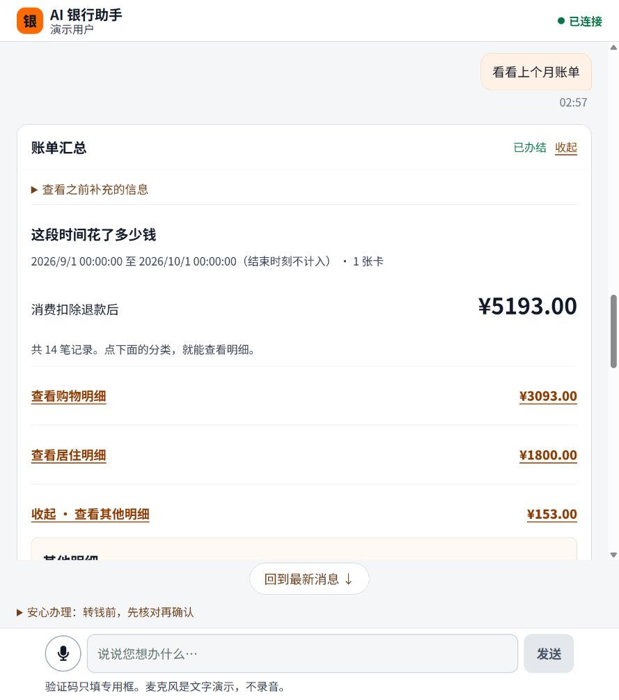
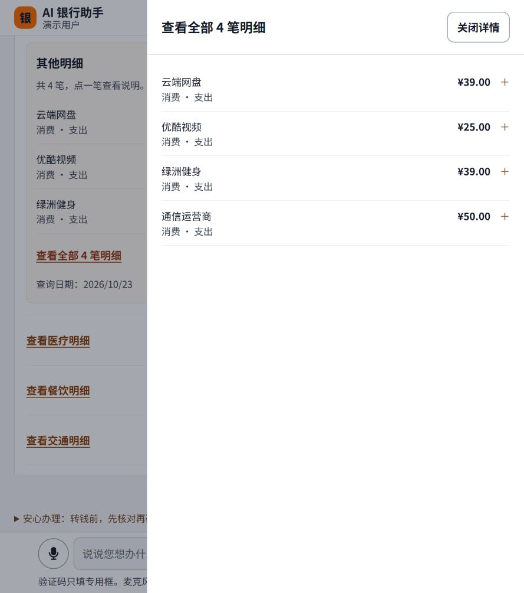
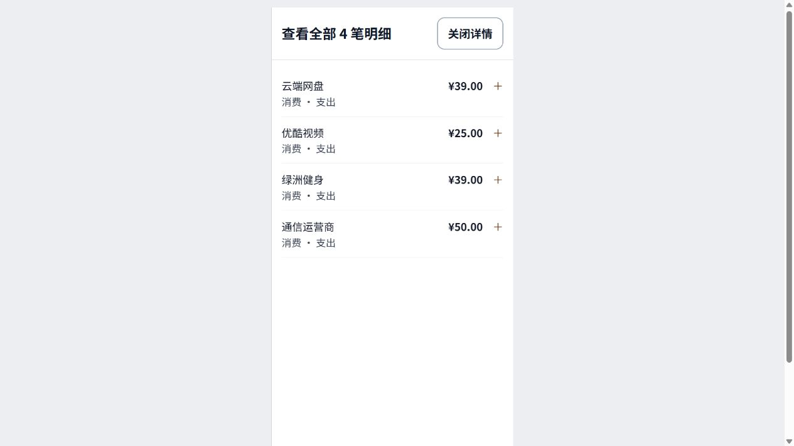

# 票14：卡片分层与稳定阅读验证

日期：2026-10-23。代码PR [#252](https://github.com/DrErwin/hackerthon-bank-agent/pull/252)，审查头 `9869ddfca8d961fedd4fb0ddd257a03dee13c163`。

Repository checks通过，PR已合并：`a3d1b576e7b8332e95256778dbc0ba0c99fc2602`。本记录区分代码交付、实际浏览器验证和仍待用户验收。

## 本地与审查

- `npm test -- --reporter=dot`：8文件59项通过；`npm run build`（TypeScript + Vite）通过；`git diff --check`通过。
- GPT-6.1-sol Standards与Spec独立代审最终头通过；修复2项P2：对话更新的屏幕阅读器通知、全部账单明细中的单笔分类遗漏。
- 依用户本会话授权代审及合并，不代表Ringo本人专业安全批准。
- impeccable手动检测1次：旧警告条侧边框保留；新内嵌结果侧边框已改为完整细边框。真实视觉批次后修正单笔信息密度及抽屉关闭按钮宽度。

## 实际页面

真实前端 `http://127.0.0.1:5177/`，原API `http://127.0.0.1:8007`。只更换前端服务目录，没有重启API或重置用户演示库。

| 检查 | 结果及范围 |
|---|---|
| 原有长会话 | 已完成记录折叠；旧输入/确认/验证步骤可展开；失败原因仍直接可见。没有来源元数据的旧子任务按可用时间展示，不猜业务归属。 |
| 新分类动作 | 来源 `8f8164ef-b2f5-4909-bd4b-bf62071ae0a3`，点击“其他明细”，在原账单该分类下显示4笔；子任务 `0df833be-dae6-5c76-9b5a-4948b8b44ac4`，没有追加顶层卡片。 |
| 刷新 | 刷新页面、展开账单和其他分类，仍是同一子任务；不需要重新查询。 |
| 明细层级 | 默认商户、金额、收支性质；单笔展开出现日期、分类和银行说明；全部4笔放进抽屉。 |
| 焦点 | 打开抽屉焦点到“关闭详情”；Escape关闭后回原“查看全部4笔明细”按钮。 |
| 阅读位置 | 展开云端网盘一笔前后，聊天容器scrollTop均为2777.3333；内容高度4980→5107，视口743。未自动跳底。 |
| 窄屏 | 临时390×844 iframe载入真实同源页面，分类、单笔、抽屉及关闭按钮可用，无可见横向溢出。检查页与临时标签已删除；不把它称为手机真机或200%缩放验收。 |

## 边界与待办

- 前端可控提示已缩短；无法安全改写的模型自由回复保留原文。用户旧会话中那段自动扣费解释仍偏技术化，应由独立话术票继续处理。
- 旧会话出现“订阅服务暂时不可用”；本票不更改后台订阅绑定或伪装为退订成功。
- 确认、验证码、取消、重试和刷新安全行为有59项测试覆盖；本次真实页面只做读账单和界面操作，没有执行转账/退订。
- 未验证真实200%浏览器缩放、手机软键盘或专业屏幕阅读器；保留Issue #227和用户最终验收。
