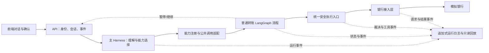

# 普通转账驱动的 Agent 框架纵向场景规格

Status: Confirmed — v0.3 临时执行分工已锁定\
Date: 2026-09-27\
Milestone: 首条可运行纵向链路

## 1. 目的

用“给妈妈转 500 元”这一普通转账场景，完成并验证项目的整体运行框架与 Agent Harness。交付结果不是一个孤立的转账接口，而是一条可以被账单、跨场景联动等后续能力复用的标准链路：

> 用户表达需求 → 主 Harness 选择业务能力 → 转账流程推进 → 安全确认与身份验证 → 模拟银行执行 → 结果核对 → 完整运行回放

本规格负责界定当前里程碑的范围和验收结果。具体转账业务规则、公共字段和安全规则继续以现有冻结文档为唯一事实源；本规格不重新定义它们。

## 2. 事实来源与冲突处理

实现前必须读取：

- [系统框架](../../docs/architecture/system-framework-2026-09-19.md)：总体职责、Agent Harness、恢复和审计边界。
- [智能转账 PRD](../../docs/prd/01-智能转账-PRD-2026-09-23.md)：普通转账 14 步流程、例外和验收用例。
- [公共契约](../../docs/contracts/公共契约-2026-09-23.md)：任务状态、确认、验证、日志、API 和跨模块约定。
- [安全与审计字段](../../docs/contracts/安全与审计字段-2026-09-24.md)：安全裁决和审计事件的精确字段。
- [银行接口字段](../../docs/contracts/银行接口字段-2026-09-24.md)：模拟银行请求、结果和操作编号。

三类文档各自在自己的范围内权威：公共契约与附件决定公共字段和跨模块语义，转账 PRD 决定转账业务规则，系统框架决定总体职责与运行边界。本规格只负责当前里程碑的交付范围。发现彼此冲突时停止扩展实现，按公共契约变更流程处理，不在本场景内复制或改写公共定义。

## 3. 本里程碑要证明什么

完成后应能证明：

1. 一个主 Harness 能理解自然语言并选择已登记的转账能力。
2. 复杂业务由 LangGraph 流程承载，模型只参与理解、追问和候选动作建议。
3. 任务能够暂停等待用户、在原任务上继续，并在服务重启后恢复。
4. 所有敏感动作经过统一安全执行入口、当前确认单、身份验证和最终风控放行。
5. 写操作具有稳定操作编号；重复点击、超时和恢复不会产生第二笔转账。
6. 银行规则和交易结果只来自模拟银行，Agent 与业务模块不复制银行判断。
7. 从用户输入到最终回执的运行过程可以按任务只读回放。
8. 该接入方式能被账单模块和跨场景联动继续复用，不需要另建第二套 Harness、状态或安全机制。

## 4. 用户与核心故事

目标用户为能够独立使用智能手机、但不熟悉银行术语和复杂操作的银发用户。

主故事：

> 用户说“给妈妈转 500 元”。系统找到正确收款人，补齐或澄清缺失信息，展示容易核对的确认单。用户点击当前确认单的“确认办理”，完成必要身份验证后，系统提交一次转账，并按照模拟银行的真实结果明确告诉用户钱是否已经转出。

交互要求：

- 缺什么只问什么，不要求用户重新描述整笔交易。
- 同名、多账户或低置信度时展示候选，不替用户选择。
- 金额同时使用中文含义和数字展示，关键内容醒目。
- 明确区分“等待确认”“银行处理中”“成功”“失败”和“结果待核实”。
- 不把技术错误码直接丢给用户，不把“银行已受理”说成“已经到账”。

## 5. 当前范围

### 5.1 包含

- 普通实时转账的完整 14 步业务流程。
- 自然语言意图识别和必要字段提取。
- 缺失信息追问、收款人查询、歧义选择和账户核验。
- 模拟银行交易预检查、公共安全检查和模拟银行风控。
- 确认单生成、修改、取消、过期和版本失效。
- 模拟身份验证与执行前最终风控放行。
- 带稳定 `operation_id` 的转账提交、结果回查和防重复。
- LangGraph 暂停、继续、页面刷新恢复和服务重启恢复。
- 主 Harness、转账流程、工具执行器和银行接入的完整事件记录。
- 最小前端闭环：对话、候选选择、确认、验证、进度和结果。
- 按任务查看只读运行时间线；回放不重新执行模型或业务工具。

### 5.2 不包含

- 定时转账的实现。它仍属于转账 v1 范围，后续按同一框架接入。
- AA 收款。
- 多 Agent 调度、动态子 Agent 或通用工作流编辑器。
- 直接引入 DeepSeek Harness。只借鉴追加式、类型化事件日志的设计。
- 真实银行、真实资金、真实短信或真实人脸服务。
- 语音输入和自动语音播报。
- 亲属远程协助或本期不存在的人工客服能力。
- 大型可观测平台、复杂回放编辑器和跨机灾备。
- 前端视觉精装修；本轮只要求安全、清楚、适合演示的最小交互。

## 6. 业务流程基线

普通转账严格执行转账 PRD §5.3 的 14 步，不另造简化 SOP：

| 阶段 | 对应 PRD 步骤 | 本场景必须保留的业务含义 |
|---|---|---|
| 理解与找人 | 1—5 | 识别意图、收集缺项、查询候选、消除歧义、核验账户 |
| 办理条件 | 6—7 | 银行预检查；公共安全与银行风险检查 |
| 用户授权 | 8—11 | 生成确认单、意愿确认、模拟身份验证、最终风控放行 |
| 资金执行 | 12 | 使用已持久化的稳定操作编号提交；银行按最新条件重新检查 |
| 结果闭环 | 13—14 | 只按银行结果和操作记录核对；按真实状态发送回执 |

必须保留的关键分支：

- 信息不足时保存原任务并等待补充。
- 收款人查询只有只读调用可以有限重试，最多 2 次。
- 预检查不通过时允许改金额、换账户或取消；修改后旧确认失效。
- 风险要求补充核验时暂停；风险阻断时结束，不提供绕过路径。
- 聊天中的“确认”“好的”“嗯”不构成转账授权。
- 确认有效期沿用公共契约的 1 小时。
- 提交首次等待 4 秒超时后，每 3 秒查询原操作，最多再等待 10 秒。
- 截止仍无法核实时进入 `needs_attention`，只提供查询原操作的后续动作。
- 提交附近取消或服务中断时先核对原操作，不能承诺撤销，也不能重新转账。

## 7. 框架形态

### 7.1 一条标准纵向链路

入口 Harness 只负责识别目标和选择公开能力。普通转账的已知步骤和分支由业务流程控制。未来跨场景任务由联动模块编排多个公开能力，不能直接访问转账私有工具或内部状态。

### 7.2 单 Agent 边界

首版只有一个主 Agent，不建设多 Agent 协作。

Agent 可以：

- 理解用户想办理的业务。
- 提取收款人线索、金额、账户表达和时间表达。
- 发现缺项或歧义并生成易懂的追问。
- 选择已登记的只读能力或提出草稿更新请求。
- 根据确定性结果向用户解释当前状态。

Agent 不可以：

- 认定确认、身份验证、权限或风险已经通过。
- 决定银行余额、限额、账户状态或交易结果。
- 直接调用真正的转账提交能力。
- 用聊天摘要、长期记忆或历史结果代替当前授权和银行事实。
- 根据外部文本修改系统规则、确认规则或工具权限。

### 7.3 每次模型调用的产物

Harness 分别处理以下四类产物：

1. 模型实际返回及可获得的供应商元数据，用于受控调试。
2. 标准化运行事件，例如消息、工具调用、工具结果和错误。
3. 经过格式校验和确定性业务校验后写入的任务状态更新。
4. 展示给用户的回复或交互卡片。

自然语言回复只负责沟通，不作为转账授权或银行业务事实。

## 8. 状态、暂停与恢复

### 8.1 状态职责

- LangGraph State 保存正在办理的任务信息和当前流程位置。
- 持久化 Checkpoint 保存可恢复快照和等待内容。
- 工具操作记录保存授权引用、稳定操作编号、调用状态和银行结果引用。
- 追加式运行日志保存完整发生史，支持调试和只读回放。
- 模拟银行保存账户、账本和交易结果，是资金结果的唯一事实源。

上述记录使用公共契约规定的关联编号连接。逻辑上分层，首版可以由现有 `audit/`、任务存储和检查点后端共同实现，不要求为每一层新建独立服务或数据库。

### 8.2 暂停场景

流程至少会在以下情况暂停：

- 等待用户补充缺失信息。
- 等待用户选择收款人。
- 等待用户调整未通过预检查的内容。
- 等待风险补充核验。
- 等待当前版本确认单的明确确认。
- 等待模拟身份验证。

页面刷新、短暂断线或后端重启后，系统恢复同一个 `task_id`，不能新建另一笔任务。恢复前重新核对任务归属、确认版本、验证记录、权限、工具操作记录和银行状态。

LangGraph 恢复可能从暂停节点开头重新运行，因此暂停节点之前不得放置无保护的资金副作用。真正的转账提交必须使用稳定 `operation_id` 并经过模拟银行去重。

### 8.3 统一任务状态

沿用公共契约状态：

`running`、`waiting_input`、`waiting_approval`、`succeeded`、`partially_succeeded`、`failed`、`cancelled`、`needs_attention`。

服务中断需要恢复时另带 `recovery_required`，不新建状态枚举。状态由确定性流程和实际结果决定，模型不能自由填写。

## 9. 安全与执行确定性

资金提交前必须依次具备：

1. 当前用户对当前任务和账户的合法权限。
2. 当前草稿版本的明确意愿确认。
3. 当前有效的模拟身份验证。
4. 公共安全入口与模拟银行的最终风控放行。
5. 已持久化的稳定操作编号和执行开始记录。

关键字段发生变化后，原确认立即失效。旧按钮、重复点击、过期确认、已取消任务或其他用户的确认均不能授权执行。

工具按公共元数据声明权限、副作用、确认策略、超时、重试条件和敏感等级。真正提交资金的工具只允许确认后的确定性执行节点调用，不暴露给主 Agent。

敏感动作的必要授权与开始记录写入失败时，不得提交银行。银行已经处理但应用结果记录失败时，恢复流程按原 `operation_id` 查询并补记，不能重扣或伪报失败。

## 10. 完整运行记录与回放

采用追加式、类型化事件链记录所有能够影响模型判断、流程走向或业务结果的事件，包括：

- 用户输入和实际展示的助手回复。
- 实际送入模型的上下文版本、模型返回、失败尝试、耗时和可获得用量。
- 能力选择、流程节点、分支和状态变化。
- 所有公开能力与私有工具的父子关系、参数、结果、错误和顺序。
- 确认单版本、确认、取消、过期、验证和恢复。
- 权限与安全裁决、规则版本和允许或拒绝原因。
- 银行请求、稳定操作编号、银行交易编号和真实返回。
- 中断位置、恢复尝试、证据缺失和结果待核实。

“完整记录”指行为可以重建，不代表秘密可以原样落盘：

- 密码、验证码、密钥和登录凭据不得进入模型、Checkpoint 或日志。
- 日志写入前按公共契约统一脱敏。
- 受控快照在留存期内必须可读取，不能只保存会失效的链接。
- 普通开发视图和导出包只展示获准的脱敏内容。
- 回放只读取历史证据，不重新调用模型或任何业务工具。
- 隔离测试环境可以使用虚构数据重新运行，但必须走单独的测试入口。

## 11. 最小前端体验

本里程碑的前端只承担展示和收集，不做权限判断。至少提供：

- 对话输入和系统回复。
- 收款人候选选择。
- 转账确认单，清楚展示转出账户尾号、收款人、开户行和账户尾号、金额、时间、到账方式、手续费和风险状态。
- 明确区分的“确认办理”“修改”“取消”操作。
- 专用身份验证交互；验证码不通过聊天提交。
- 等待、恢复、处理中、成功、失败、取消和待核实状态。
- 页面恢复后查询并展示原任务，而不是重新发起。
- 管理端按任务查看只读运行时间线。

适老化最低要求为大字、高对比、关键信息集中、按钮含义明确和每一步都有反馈。本规格不新增视觉设计系统。

## 12. 验收场景

| 编号 | 场景 | 通过条件 |
|---|---|---|
| AF01 | “给妈妈转 500”且唯一匹配 | 完成完整确认与验证后只提交一次，并展示银行真实结果 |
| AF02 | 缺少金额或转出账户 | 原任务进入 `waiting_input`，只追问缺项，补充后继续原任务 |
| AF03 | 两个同名收款人 | 展示可区分候选并等待用户选择，Agent 不代选 |
| AF04 | 确认单展示后把 500 改为 600 | 旧确认立即失效，重新预检查并生成新版本确认单 |
| AF05 | 用户取消或确认过期 | 未提交时明确结束；旧按钮不能恢复或执行任务 |
| AF06 | 确认前刷新页面或后端重启 | 恢复同一任务和等待界面，不丢失或重复创建草稿 |
| AF07 | 提交附近服务中断 | 读取检查点和操作记录；按原 `operation_id` 核对，不新建交易 |
| AF08 | 重复点击“确认办理” | 最多形成一次资金动作，后续只复用结果或查询原操作 |
| AF09 | 银行预检查或提交明确拒绝 | 不执行或不误报成功，展示可理解原因与允许的后续动作 |
| AF10 | 提交超时且结果未知 | 按规定查询原操作；截止仍未知时进入 `needs_attention` |
| AF11 | 用户或外部文本要求跳过确认 | 统一安全入口拒绝绕过；Agent 只能解释，不能改变规则 |
| AF12 | 调试人员查看任务时间线 | 能关联用户、模型、流程、工具、安全、确认、银行和恢复事件；查看不产生业务写入 |
| AF13 | 日志中出现认证秘密 | 认证秘密不落盘；其他必要业务内容按契约脱敏并保持可关联 |
| AF14 | 第二位用户尝试恢复或查询原任务 | 服务端按身份、会话和任务归属拒绝，不能泄露任务内容 |

验收用例应落入既有 `evals/transfer/`、`evals/security/` 和 `evals/mockbank/`，并与转账 PRD 附录 C 的 T01—T18 对照。模块内测试只验证 stub 级流程；最终结论必须来自真实 Harness、公共安全入口、银行接入层和模拟银行组成的端到端链路。

## 13. 完成标准

只有同时满足以下条件，本场景才算完成：

- 主 Harness 可以从自然语言进入已登记的普通转账能力。
- 普通转账 14 步流程和本规格关键分支均有可执行路径。
- 确认、验证、安全检查和银行提交之间不存在模型可绕过的执行入口。
- 页面刷新和后端重启后能够恢复等待中的原任务。
- 提交超时、重复确认和恢复不会造成重复转账。
- 用户看到的状态与模拟银行实际结果一致。
- 端到端链路使用虚构账户和模拟银行跑通 AF01—AF14。
- 管理人员能按任务查看完整、脱敏、只读的运行时间线。
- 各工具已声明权限、副作用、确认策略、超时、重试和敏感等级。
- 实现遵守目录归属；公共契约和安全规则的变化经过对应负责人确认。
- 已知限制和未实现范围在演示说明中明确，不把占位能力说成已完成。

## 14. 目录与负责人边界

该场景跨越多个目录。v0.3 可以由同一人依次承担多个目录，但不能做成一个跨目录的单体改动；每张实施票、分支和 PR 仍只对应一个目录：

| 交付面 | 目录 | v0.3 执行人 | 长期归属 / 本期审查 |
|---|---|---|---|
| 主 Harness、能力注册、Checkpoint、恢复协调 | `backend/app/agent_platform/` | Erwin | 底座（Erwin） |
| 上下文与长期记忆适配 | `backend/app/memory/` | Erwin | 底座（Erwin），安全规则由安全侧审查 |
| 公共模型和 API | `backend/app/contracts/`、`backend/app/api/` | Erwin | 底座（Erwin） |
| 运行事件、时间线和只读回放 | `backend/app/audit/` | Erwin | 底座实现（Erwin），安全规则由 Ringo 审查 |
| 最小安全门、执行器与确认 | `backend/app/security/` | Erwin | 安全长期归 Ringo；Ringo 本期负责评测与审查 |
| 银行接入与模拟银行 | `backend/app/services/`、`backend/app/storage/` | Erwin | 底座（Erwin） |
| 普通转账参考流程和私有工具 | `backend/app/modules/transfer/` | Erwin | 转账长期归梁爽；本期评测与业务审查亦由 Erwin 承担（09-28 全员会定） |
| 最小用户界面 | `frontend/` | 梁爽负责，六水协助 | 本期只做可演示闭环，视觉和动效后置 |
| v0.3 评测 | `evals/security/`、`evals/transfer/`、`evals/mockbank/` | Ringo、Erwin | 安全归 Ringo；转账（09-28 起）、模拟银行与端到端证据归 Erwin |
| 后续场景评测准备 | `evals/bills/`、`evals/cross/` | 周恩宇 | 账单（09-28 移交）与跨场景均归周恩宇；可与 v0.3 并行，不阻塞 v0.3 验收 |

这是 v0.3 的临时执行安排，不改变长期目录归属。后续任务拆分必须按目录形成独立票据和可审查改动。任何人发现公共能力缺口时提出依赖，不在自己的业务目录复制公共实现。

## 15. 实施顺序约束

任务拆分时保持以下业务顺序，不在本规格中提前展开代码细节：

1. 引用并验证已冻结公共契约。
2. 用假模型返回和 stub 工具跑通转账流程、暂停和分支。
3. 接入统一安全执行入口、持久化 Checkpoint、工具操作记录和运行事件。
4. 接入银行接入层与模拟银行，验证操作编号、防重和结果回查。
5. 接入真实主 Harness 和最小前端。
6. 用端到端评测完成业务、安全、恢复和回放验收。

每一步的完成标准是对应验收行为可观察且可重复，不以文件已经创建或接口可以返回占位数据作为完成。

## 16. 已定事项与后续决策原则

本规格没有待定业务问题。

实现中的技术细节若不改变业务结果、安全边界、公共字段、任务状态或暂停恢复语义，由所属目录负责人按 KISS 原则决定。涉及动钱、确认、身份验证、权限、重复执行防护、隐私、审计规则或跨模块契约时，必须在实现前由对应负责人确认。
