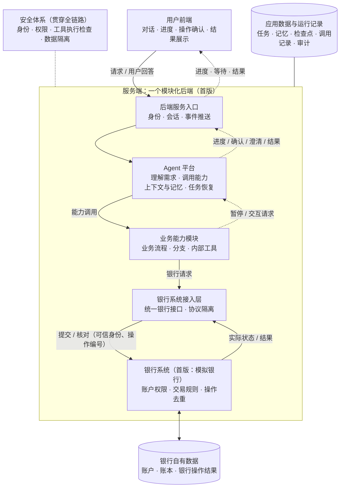
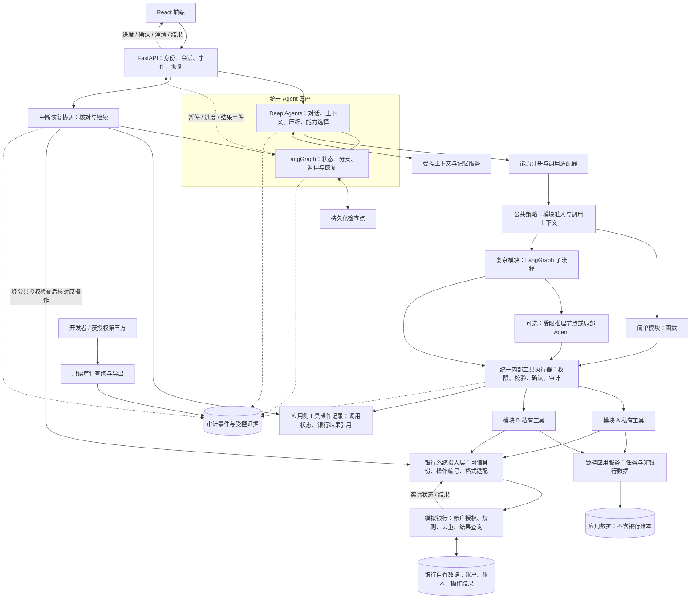
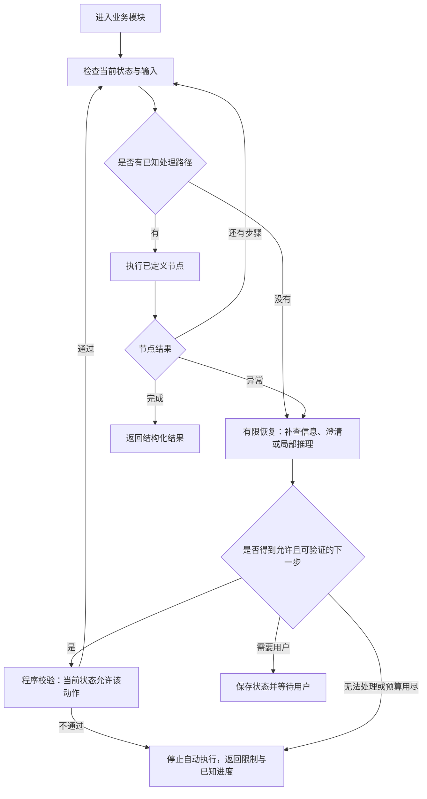

# AI Banking Agent 系统框架

> 09-26 契约补齐：审计外壳增加实际操作者 session_id 与 target_session_id；系统触发无登录会话，不冒用历史授权会话。敏感授权快照跨重置保留，字段见[安全与审计附件 §4](../contracts/安全与审计字段-2026-09-24.md)。用户记忆查看／删除由框架适配提供最小受控入口，见[公共契约 §7.6](../contracts/公共契约-2026-09-23.md)，不另建记忆存储。
> 最后更新：2026-09-30
> 状态：最新版架构基线；总体系统架构与 Agent、安全、恢复、审计设计已对齐。实际实现与验证进度见 [v0.3 完成情况](../versions/v0.3.0/completion.md)。
> 读者：项目负责人、底座开发者、各业务线开发者。
> 范围：系统总体架构（各部分职责与边界、银行接缝）与 Agent 框架（扩展方式、安全边界、团队接口）；不定义具体银行业务流程、额度规则或场景交付范围。
> **本文为最新架构基线，后续开发以本文（2026-09-19）为准。** 更早的草案仅作历史参考，其与本文冲突的内容不再适用。开发判据仍以 [开发核心原则](development-principles.md) 为准。
> 本轮重点：补齐银行侧权限与记录归属，统一总图和详细图中的调用路径，补充银行开发分工、替换条件及对应验收要求。

## 第一部分 总体系统架构

### 1. 系统总览

系统由七个部分组成：用户前端、后端服务入口、Agent 平台、业务能力模块、银行系统接入层、银行系统（首版为模拟银行）、数据与运行记录。安全与权限控制不是其中一部分，而是贯穿全部部分的公共约束。

请求的主链路：**用户前端 → 后端服务入口 → Agent 平台 → 业务能力模块 → 银行系统接入层 → 银行系统**。链路上任何需要用户决定的点都会暂停并回到前端，用户回答后沿原任务继续，形成确认回环。



读图判据三条，改图时不得破坏：

1. **确认回环必须可见。** 业务模块或 Agent 平台在敏感操作前暂停，等待经后端推送的确认或澄清，用户回答后沿原任务继续。只画单向请求箭头的图不合格——「动钱必过确认门」在总图上的表达就是这条回环。
2. **银行系统是链路终点的实组件。** 首版它是团队自建的模拟银行，不是外部依赖的云朵；它的位置和接口为将来替换真实银行预留。
3. **职责划分不代表部署单元。** 首版沿用「一个模块化 Python 后端」，服务端框内包含模拟银行，各部分可同进程运行；银行通过接入层调用，保持独立的逻辑边界。应用记录与银行数据分别由所属服务管理，即使使用同一数据库文件，也不能跨边界直接读写表。

两件事有意不进总图：

- **模型服务不是独立部分。** 使用哪个模型是 Agent 平台的一项配置；供应商切换边界在 Agent 框架详解（第 3.2 节）中定义。
- **审计日志归入数据与运行记录。** 总图不为它画独立入口；查看与导出的权限规则在第三部分（第 12 章）单独定义。

### 2. 各部分职责与边界

| 部分 | 负责什么 | 边界：不做什么 |
|---|---|---|
| 用户前端 | 对话界面、进度与等待状态展示、敏感操作确认、结果展示 | 不做权限判定，不直接访问业务数据与银行接口 |
| 后端服务入口 | 登录身份与会话管理、请求受理、事件推送、恢复与取消入口 | 不理解业务语义，不执行业务规则 |
| Agent 平台 | 意图理解与能力选择、上下文与记忆、任务暂停恢复、模型配置 | 不执行银行规则，不绕过安全检查直接读写数据 |
| 业务能力模块 | 业务流程与分支、内部工具、澄清与确认请求、任务状态 | 不直连银行，不复刻银行侧规则 |
| 银行系统接入层 | 统一银行接口、协议与格式隔离、可信身份与操作编号传递、结果查询 | 不做业务决策，不含银行规则，不把模型参数当作身份凭证 |
| 银行系统（模拟银行） | 账户与账本、账户操作权限、交易规则、限额与风控、银行操作去重及实际结果查询；模拟身份验证（验证码 / 人脸）、预约转账到点执行、外部生活服务 Mock 与环境重置（演示支撑，09-24 定） | 不理解自然语言，不与前端直连，不依赖 Agent 代替自身授权检查 |
| 数据与运行记录 | 应用侧保存任务、记忆、检查点、工具调用及审计；银行侧保存账户、账本及银行操作结果 | 无业务逻辑，读写只经所属服务；应用不能直接访问银行表 |

安全与权限控制落在后端入口、统一工具执行器、银行服务入口和各自的数据访问层：分别检查身份与任务归属、工具与确认权限、具体账户和操作的授权、数据访问范围。前端负责呈现和收集用户动作，最终授权由服务端决定。外层调用获准不等于内部动作放行，获准使用某个工具也不等于获准操作任意账户。逐边界的安全要求见第 10 章。

#### 2.1 Agent 与银行系统的接缝

这是 Agent 应用与银行之间的逻辑边界，同进程部署也必须遵守。以下五条判据同时是模拟银行（H3）的验收口径：

1. **只经接入层。** 业务模块发起的银行请求一律通过银行系统接入层，不直连数据库、不引用银行内部表。接入层只做协议与格式隔离，不含任何业务决策。
2. **规则在银行侧。** 余额校验、限额、风控、账户状态机等银行规则全部在模拟银行内实现并执行；Agent 侧不复刻规则，不把历史判定当作新操作的授权依据。允许保存原操作回执供展示、审计和恢复核对。
3. **身份可信，账户逐次授权。** 用户身份由后端登录上下文确定，经接入层传递；模型和前端提供的账户编号仅是请求参数。模拟银行按可信身份检查是否有权查询或操作指定账户，以及是否有权查询指定操作结果；即使工具已获准或用户已经确认，也不能跳过银行侧检查。
4. **结果只认银行返回。** 银行记录是银行操作结果的事实来源，应用侧工具记录保存其返回结果或引用。提交前持久化稳定操作编号；同一动作重试与恢复沿用该编号。银行在相应身份范围内对同一编号去重，相同编号却参数不同必须拒绝；提供按原编号查询状态与结果的接口。超时或本地缺记录不等于银行未执行。
5. **在契约兼容时替换。** 替代银行满足相同的能力、授权方式、操作去重和结果状态约定时，只替换接入实现，Agent 平台与业务模块保持不变。若新增认证步骤、异步受理或缺少结果查询等能力，必须明确差异，调整受影响的契约、流程或交互并重新验收，不能静默假装兼容。首版只接自建模拟银行。

首版由转账场景第一个使用这条边界；接口字段在 09-25 契约冻结时定稿。

#### 2.2 与后文的关系

第二部分展开总图中「Agent 平台」与「业务能力模块」两格的内部设计，其结构图（第 4 章）即这两格的放大；第三部分展开安全、恢复与审计。模拟银行的内部实现由银行基建专项定义，本文只约束它的边界与接缝。

## 第二部分 Agent 框架详解

### 3. 框架决定

采用 **Deep Agents Harness + LangGraph 运行引擎 + 可插拔业务模块 + 统一安全执行入口**。

Harness 可以理解为 Agent 的公共工作底座：模型如何调用、对话如何管理、历史如何压缩、工具如何接入，都由这一层统一组织。LangGraph 是底下负责状态、分支、暂停与恢复的运行引擎。[官方框架定位](https://docs.langchain.com/oss/python/deepagents/overview)

业务模块对外提供稳定的能力入口，内部可以是普通函数、带分支的流程图，或按需使用的局部 Agent。主 Agent 不需要了解每条业务线的所有步骤和内部工具。

| 决定 | 当前选择 | 目的 |
|---|---|---|
| 部署结构 | 一个模块化 Python 后端，前端 React，接口 FastAPI | 降低启动、调试和联调成本 |
| 公共 Agent 底座 | Deep Agents，统一创建和配置 | 复用上下文管理等现成能力 |
| 流程引擎 | LangGraph | 承载需要明确分支与暂停恢复的业务模块 |
| 扩展单元 | 业务能力包 | 团队按模块独立开发 |
| 工具组织 | 对外能力目录 + 模块内部工具目录 | 控制主 Agent 的工具数量和权限范围 |
| 数据格式 | 后端 Pydantic，导出接口格式供前端使用 | 统一输入、输出和错误格式 |
| 数据存储 | SQLite/SQLModel 起步；运行状态和记忆分别接持久化后端 | 单机演示方便，存储职责清楚 |
| 通信 | 普通 HTTP 请求 + SSE 事件 | 支持消息、进度和等待用户的状态 |

团队并行开发通过模块接口实现。运行时是否同时执行多个任务，是另一项选择；首版不以多 Agent 并发为前提。

#### 3.1 首版建设边界

| 首版直接实现 | 保留扩展位置，暂不实现 |
|---|---|
| 一个主 Harness，一种公共能力接入契约 | 独立子 Agent 的第二套接入机制、多 Agent 调度 |
| 函数模块与一个带分支的流程模块 | 通用工作流编辑器、动态插件安装 |
| 框架自带压缩、最小持久化记忆与用户隔离 | 自建压缩引擎、完整记忆治理平台 |
| 受控工具、确认、进程中断恢复 | 无边界的智能异常探索、通用分布式调度 |
| 只读审计时间线和脱敏证据包导出 | 大型审计平台、复杂可视化回放编辑器 |
| 模块契约检查与最小端到端评测 | 同时接入多套评测平台 |

注册中心先用显式清单。适配器只做格式转换、可信上下文传递和事件衔接；执行位置以 LangGraph 为准，不另外自建一套流程引擎。任务摘要用于查询、归属和恢复定位，不独立决定图的下一步。

#### 3.2 模型供应商替换边界

主 Agent、压缩摘要和未来局部推理统一经过底座模型入口。业务模块只声明所需能力或逻辑模型角色，不直接调用某供应商 SDK、不读取供应商密钥、不内嵌供应商模型名称。

底座集中处理模型选择、上下文预算、超时、供应商特有参数及返回格式。切换供应商后，必须用同一套用例验证工具调用、结构化结果、流式输出和压缩；兼容接口不等于效果或行为完全一致。

首版通过配置切换，不做运行中的自动跨供应商切换。已经开始的任务记录原模型与配置版本；恢复时不静默替换。原配置不可用时，先暂停并明确新的运行配置，不能把供应商故障变成一次未记录的行为改变。

### 4. 整体结构

本章展开 Agent 平台与业务能力模块，并画出它们与公共安全、存储和银行的接缝。统一执行器与审计属于公共底座，不由每个业务模块各建一套；银行操作与应用数据访问沿不同入口执行。



图中的“统一执行器”是公共代码组件，各模块都调用同一套实现，不要求新增网络服务。它既保护主 Agent 直接使用的工具，也保护子流程和局部 Agent 使用的内部工具。

恢复协调是底座中的轻量组件，读取已有检查点和工具操作记录；银行结果不确定时，经公共授权服务检查当前身份与任务归属，再通过银行接入层查询原操作。核对完成后调用 LangGraph 继续执行，不直接读取银行表。正常执行与恢复中的银行查询都要记录审计；审计读取端不连接执行入口，不持有业务写入权限。

### 5. 复杂业务怎样接入

#### 5.1 三种模块实现，共用一个对外契约

| 实现方式 | 适用特点 | 对外表现 |
|---|---|---|
| 函数模块 | 一次明确调用即可完成 | 一个能力入口，返回统一结果 |
| 流程模块 | 多步骤、多条件分支，需要暂停、恢复或检查状态 | 同样是一个能力入口，内部使用 LangGraph 子流程 |
| 流程 + 局部 Agent | 某一段需要理解非标准信息或选择后续动作 | 外部接口不变，只在内部特定节点使用模型 |

复杂银行能力优先采用流程模块。已知条件和允许的路径由代码表达；需要语言理解或探索的部分才交给模型。不要要求每个模块都复制一套 Router、Planner、执行器和记忆系统。

注册中心记录模块类型，但主 Agent 看到的是能力名称、用途、输入要求和可返回的状态。模块以后由函数升级为子流程，只要外部契约兼容，主 Agent 和前端就不必跟着重写。

#### 5.2 已知分支与意外情况分开处理



上图是框架模式，不是具体银行 SOP。恢复环节必须有结束条件：最大步骤数、重试次数、运行时间和模型调用预算由底座提供，模块只能在批准范围内配置。

这里的“有限恢复”指运行期间的异常处理；进程被杀或服务崩溃后的任务恢复见第 11 章。AI 只能理解异常、提出补查/澄清/候选动作，确定性代码检查当前状态、允许动作和权限后才执行。AI 不能自行创建新的流程路径、放宽规则或修改成功标准。首版可采用预设分支、有限重试与用户澄清，不以独立恢复 Agent 为前提。

| 异常类别 | 框架行为 |
|---|---|
| 输入不足或含糊 | 返回澄清请求，保存当前任务位置 |
| 已知条件不满足 | 走已定义分支，返回可解释状态 |
| 临时技术故障 | 只对明确可安全重试的动作做有限重试 |
| 写操作结果不确定 | 查询和核对原操作；不能把超时直接当失败重做 |
| 未知情况 | 进入有限恢复；无法确定时停止或请求人工处理 |
| 权限拒绝 | 停止相应动作；不得通过换工具、换模块或换 Agent 绕过 |

“人工处理”在首版表示前端展示需要用户决定或暂不支持，并不假设已有人工客服系统。

#### 5.3 与 Harness 的具体衔接

默认通过公共调用适配器，把流程模块包装成主 Agent 可调用的能力工具；适配器负责输入输出转换、执行上下文、事件和恢复关联。这样可以保留强类型参数，也便于集中检查模块准入。

Deep Agents 另有 `CompiledSubAgent` 接口，可接入已经编译的 LangGraph 图。本版仅把它保留为后续扩展，不与默认工具适配路线同时建设；确实需要独立上下文委派时再启用。自定义图的状态格式与 Harness 消息接口仍需适配。[官方子 Agent 接入](https://docs.langchain.com/oss/python/deepagents/subagents)

函数包装不等于恢复能力已经完成。首轮必须实测：内部暂停能否传至前端、重启能否恢复原任务、是否重复执行。工具间接调用的子图不一定能被通用图检查器完整展示，所以模块必须主动发出进度事件。[LangGraph 子图文档](https://docs.langchain.com/oss/python/langgraph/use-subgraphs)

### 6. 业务内部工具怎样组织

采用两级目录，统一执行策略。

| 目录 | 谁能看到 | 内容 |
|---|---|---|
| 对外能力目录 | 主 Agent | 每个业务模块的少量公开入口 |
| 模块内部工具目录 | 所属流程或获准的局部 Agent | 查询、校验、计算、外部服务调用等内部能力 |

工具先经过统一注册和安全包装，再交给模块使用；不能同时向模型提供未包装的原始工具。内部工具无需都展示给主 Agent。

普通格式转换、纯计算等内部辅助函数，不必全部注册成模型工具。但涉及数据访问、外部调用或状态修改的能力，必须通过公共授权服务或受保护工具入口。

每个工具的注册信息包含：唯一名称、所属模块、输入输出格式、需要的权限、是否有副作用、确认策略、超时、重试条件、结果敏感等级。模块提供声明，中央策略做最终裁定；未声明权限与副作用的工具不能自动启用。

跨模块协作只调用公开能力接口，或者使用明确划为共享基础能力的服务。模块 A 不直接拿模块 B 的私有工具、数据库表或可变状态。框架禁止循环委派并限制调用深度。

首版这些都是项目内 Python 模块，不强制 MCP 化，也不开放用户上传可执行插件。模块隔离是代码和权限设计上的边界，不能宣称它等同于操作系统沙箱。

### 7. 上下文、记忆与执行状态

| 信息 | 管理者 | 生命周期与访问范围 |
|---|---|---|
| 主对话历史与摘要 | 公共 Harness | 按用户与会话隔离 |
| 模块任务状态 | LangGraph 持久化检查点 + 模块状态格式 | 按任务保存，用于正常暂停及强行中断后的恢复 |
| 局部推理上下文 | 底座提供的统一 Agent 创建器 | 只传入本任务需要的信息，返回必要结果 |
| 临时大段材料 | 受限虚拟文件空间 | 按用户、会话或任务隔离，有清理规则 |
| 用户长期偏好 | Deep Agents 记忆机制，底座统一接入 | 按用户隔离，遵守禁止记忆清单，可查询和删除 |
| 系统规则、Skills | 团队维护 | Agent 只读，不能用工具结果覆盖 |
| 应用权限与确认记录 | 公共安全服务与应用数据库 | 确定性记录，不以聊天摘要替代 |
| 银行账户、账本与银行操作结果 | 模拟银行及其自有数据 | 银行事实来源；应用只经接入层请求或查询 |
| 工具操作记录 | 公共执行器与应用服务 | 保存调用、授权、操作编号及银行返回结果或引用；未知结果向银行核对 |
| 审计事件与证据 | 公共审计组件 | 供开发者和获授权第三方检查历史链路，不驱动执行 |

Deep Agents 的历史压缩与大结果移出上下文可以复用；模型上下文上限和压缩阈值需按实际供应商配置。自定义流程不会因为处在 Deep Agents 下面就自动获得所有上下文中间件；需要局部 Agent 时，统一由底座创建并显式装配。[上下文机制](https://docs.langchain.com/oss/python/deepagents/context-engineering)、[定制与中间件](https://docs.langchain.com/oss/python/deepagents/customization)

**09-24 第七批，Erwin 修订**：用户长期记忆的存储与日常记忆机制交给 Deep Agents，底座统一接入和配置，业务模块不另建全局记忆存储。契约只列演示预置、禁止记忆清单，以及用户隔离、可查看删除、重置恢复等边界；不另设计何时记忆或逐次确认保存的流程。具体持久化后端与框架配置在实现时验证，仍须满足既定重启恢复要求，不假定无需配置即可自动生效。预置与限制见[公共契约 §7.4—7.5](../contracts/公共契约-2026-09-23.md)。团队只读规则、安全授权、任务检查点、银行事实与审计继续分别管理。[记忆机制](https://docs.langchain.com/oss/python/deepagents/memory)、[存储后端](https://docs.langchain.com/oss/python/deepagents/backends)

默认每次新业务调用使用独立的子任务状态；澄清、确认和恢复继续原任务，而不是新建另一个任务。只有明确需要业务专属的多轮累积状态时，才配置长期子会话。

框架维护 `thread_id`（会话）、`task_id`（业务任务）、`invocation_id`（调用）与检查点位置的关联。用户身份来自服务端登录上下文，不能由模型填入。相同会话/任务的修改与恢复请求先串行处理，防止两个请求同时推进一个执行位置。

### 8. 业务模块的最小对接契约

以下是项目约定，不是 Deep Agents 自动提供的插件协议。先定义契约，再独立开发模块。

公共契约由 Erwin 负责定稿，保存在唯一代码来源中：能力调用、执行上下文、工具元数据、结果、错误、事件及审计格式由各模块共同引用。模块本地只定义自己的业务输入与内部状态，不复制公共格式。公共契约修改走版本和兼容性审查，模块内部实现可独立演进。

后端以 Pydantic 做运行时格式校验，配合静态类型检查和接口测试；前端从公共接口生成类型。只有 Markdown 约定，不算完成契约交付。

| 项目 | 模块需要交付什么 |
|---|---|
| 模块清单 | 名称、版本、用途、负责人、实现类型及依赖 |
| 公开入口 | 主 Agent 可以调用的能力及输入输出格式 |
| 私有工具 | 内部工具清单与风险声明；纯辅助函数可留在内部 |
| 状态格式 | 需要保存的数据、任务状态和恢复所需信息 |
| 交互请求 | 需要用户澄清、批准或选择时的结构化内容 |
| 可见计划 | 需要多步展示时提供计划及修订事件，实际进度对应步骤编号 |
| 测试 | 正常、分支、暂停恢复、异常和权限拒绝的独立用例 |

统一结果至少包含 `task_id`、`status`、必要数据或结果引用、可展示说明、错误码及允许的后续动作。大段内部材料不直接拼回主对话。

建议状态：`running`、`waiting_input`、`waiting_approval`、`succeeded`、`partially_succeeded`、`failed`、`cancelled`、`needs_attention`。状态由执行结果确定，不能由模型自由编造；其中部分成功由模块在确有多项结果时使用。

服务中断后的任务可以另外携带 `recovery_required` 标志和原因，表示需要核对后才能继续；它不代表业务失败。明确取消与故障中断分开记录。任务级编号跨重启保持稳定，每次实际运行尝试有独立 `run_id`。

公开 API 统一使用“开始、补充输入/恢复、查询状态、取消”的语义。取消请求只表示请求停止；最终是否已取消或仍需核对，由任务执行状态决定。

底座把 LangGraph 的暂停事件转换为前端交互请求；用户回答交回原任务。不要把暂停捕获成普通失败，也不要把 `waiting_approval` 当成能力已完成。恢复定位信息由服务端持有，客户端只提交获准的回答或操作。

SSE 事件统一包含事件编号、会话、任务、模块和事件类型。进度与结果可见，内部模型思考与压缩内容默认不可见。断线后用任务状态查询补齐，事件重放按实现能力提供，不假设 SSE 库自动保存历史。

### 9. 团队并行开发边界

| 工作块 | 负责内容 | 对外提供 |
|---|---|---|
| Agent 底座 | Harness 创建、模型适配、上下文与记忆（memory 随 harness，09-24 定）、模块接入、检查点与恢复 | 公共运行接口、模块适配器 |
| 审计与回放（`audit/`，09-24 定） | 运行日志写入机制（事件外壳、追加写、与工具结果同事务）、只读时间线与 JSON 证据包导出；**审计规则（记什么 / 脱敏 / 谁可看）由安全侧定** | 全系统共用的审计写入接口与只读查看端 |
| 安全 | 策略、统一工具执行器、用户隔离、审计规则与记忆安全规则 | 所有模块共用的服务 |
| 业务模块 | 公开能力、内部流程、私有工具、状态与测试 | 遵守统一契约的能力包 |
| 前端/API | 身份、任务交互、事件展示、恢复和取消 | 稳定的用户交互协议 |

银行接口与模拟银行归底座（Erwin）维护：公共接口在 `contracts/` 定义；接入实现建议放在 `services/bank_gateway/`，模拟银行放在 `services/mock_bank/`，银行专属数据访问放在 `storage/mock_bank/`。这些仍属于底座共享目录，业务线不直接修改。Ringo 负责共同审查身份传递与授权边界；银行账户权限由模拟银行执行，不在 Agent 侧复制规则。

Erwin 同时提供统一的联调入口、可重置的虚构账户数据、银行接口测试和可控异常样例（拒绝、超时、重复提交、结果待核实）——重置能力、演示开关与种子八张表已落进 [MockBank-PRD](../prd/MockBank-PRD-2026-09-23.md)。业务同学通过接入层使用这些能力，不能各自造一套银行规则。API 由底座维护；前端由梁爽负责、六水协助（2026-09-25 确认），前后端契约由 Erwin 统筹（最小接口需求见[契约大纲](../contracts/公共契约-2026-09-23.md)第 6.2 节）。

业务开发者可以先用假的模型返回和模拟工具，独立验证流程，再接入真实 Harness。底座提供同一个模块模板和测试入口，避免各业务线重新设计恢复和安全机制。

每项能力先交输入、预期结果和异常用例，再开发实现。模块进入可用清单前，必须通过公共契约、安全声明和接口测试；端到端链路使用真实 Harness 验证，最终由人验收。缺少权限或副作用声明的工具在注册时拒绝，不能靠事后代码审查补救。

代码组织如下（**目录骨架已建立**，2026-09-24，各目录带 README 说明归属与边界）：

```text
backend/app/
  contracts/            唯一公共契约：调用、结果、事件、安全上下文、审计
  api/                  请求、身份、事件与恢复接口
  agent_platform/       Harness、模型适配、注册中心、流程适配器、恢复协调
  audit/                运行日志与只读回放：事件写入、时间线查看、证据包导出（09-24 定，规则由安全侧定）
  security/             策略、工具执行器、确认与审计规则
  memory/               Agent 长期记忆与上下文后端（harness 标配；09-24 归底座，安全规则由安全侧定）
  modules/
    <module_name>/
      manifest          模块说明、公开入口与依赖
      contracts         模块专属输入与内部状态，引用公共契约
      workflow          可选：带分支的流程图
      tools             模块私有工具
      reasoning         可选：局部推理节点
      tests             模块独立验证
  services/             可复用的应用能力
    bank_gateway/       银行接入实现；业务模块唯一银行调用入口
    mock_bank/          模拟银行；账户权限、交易规则、去重与结果查询
  storage/              数据访问、迁移、持久化适配
    mock_bank/          仅供模拟银行使用的银行表与数据访问
```

目录名是建议；模块内的文件形式在接口设计时确定。内部模块靠显式登记装配，首版不做运行时上传、自动安装或热更新。

**仓库顶层布局（09-24 定；前端框架 09-29 改定 React）**：`backend/`（本树）+ `frontend/`（React，梁爽负责、六水协助，脚手架开工时建）+ `evals/`（评测集总目录：三业务 + Ringo 安全总集 + Erwin Mock Bank 集；模块测试核对代码功能，业务评测核对场景行为，E2E 用例负责整条链路的验收）+ `docs/`（文档唯一事实源）+ 根 `README.md`。演示操作端已定为简单管理页，不因该需求另建 `scripts/`；CI 与 CODEOWNERS 随远端建立落位。

**演示管理边界（09-24 第五批已定）**：管理入口由后端检查权限，不挂到 Agent 工具目录。底座协调停止新业务、等待在途执行完成及整体重置，各模块只处理自己的存储；银行回种子态，应用会话 / 任务 / 确认 / 验证失效，memory 恢复演示预置，故障和逻辑时钟归初始状态。历史 audit 保留并区分演示轮次；未完成不得报告成功，旧任务不能操作新环境。时间快进只推进银行业务时间，验证码、确认与网络等待按真实经过时间计时。行为与验收以[公共契约第 7 / 9 章](../contracts/公共契约-2026-09-23.md)为准。

## 第三部分 安全、恢复与审计

### 10. 安全边界

安全由底座统一提供，模块负责调用。主 Agent 能选择能力，但不能修改授权规则。

| 边界 | 框架必须保证 |
|---|---|
| API → 会话与恢复 | 校验登录身份、会话归属、任务归属及恢复请求 |
| Harness → 业务模块 | 只开放准入的能力，传递服务端可信上下文 |
| 业务模块 → 内部工具 | 按每次实际调用校验权限、参数和必要确认 |
| 工具 → 应用服务 | 状态修改在服务入口再次验证关键条件；恢复重放不能产生重复副作用 |
| 银行接入层 → 模拟银行 | 传递服务端可信身份；银行逐次检查目标账户及操作权限，查询历史操作结果同样鉴权；银行规则仅在银行侧执行 |
| 工具结果 → 模型 | 限制字段与大小，标记来源；自由文本不获得修改权限或规则的资格 |
| 模型 → 记忆 | 受控写入，防止外部内容变成长期系统指令 |
| 模型 → 前端 | 只发送允许展示的内容与业务事件，过滤内部压缩和推理消息 |

不能因为外层“业务模块调用”获准，就放行内部全部动作。内部工具即使不向主 Agent 展示，仍然必须经过同一安全执行器。敏感动作的确认绑定具体调用和参数；参数改变后重新检查，不能依赖自然语言中的“之前已经同意”。

Deep Agents 的人工确认机制负责暂停与恢复，项目负责身份与授权判定。其文件权限设置主要覆盖内置文件工具，不自动保护业务工具；因此不能把文件权限配置当作整个系统的权限系统。[人工确认](https://docs.langchain.com/oss/python/deepagents/human-in-the-loop)、[文件权限范围](https://docs.langchain.com/oss/python/deepagents/permissions)

首版仅开放受限虚拟文件空间，不接通用 Shell 或任意代码执行。默认通用子 Agent、动态创建子 Agent 与递归委派关闭；后续业务确有需要时，启用显式登记的局部 Agent，并明确指定工具清单、预算与安全配置。

局部 Agent 的自定义中间件和自定义编译图不能假设自动继承主 Agent 的安全设置。公共创建器与工具执行器承担一致性检查；模块不能自行创建一个不受管理的 Agent。

审计记录调用链、模块、工具、规则判定、状态变化和必要结果引用；敏感数据在进入模型或日志前最小化处理。“只追加日志”是应用约束，本文不据此宣称已实现防篡改。

读取审计信息同样需要鉴权、范围限制和脱敏。第三方默认获得经授权导出的证据包，不获得生产数据库、会话恢复或工具执行权限。具体证据范围见第 12 章。

### 11. 强行中断后的任务恢复

#### 11.1 恢复目标

重点应对流程执行到一半时进程被杀、服务崩溃、宿主机重启等情况。目标是找回已保存进度、查清已执行动作，再继续未完成工作，不让用户从头重办，也不重复执行已完成的动作。

本版假设持久化文件仍可读取。磁盘损坏、存储丢失和整机灾备属于后续运维范围；不能把流程恢复宣称为所有故障下都不丢数据。

恢复粒度是已持久化的步骤或任务边界，不是程序被终止时的任意代码行。尚未保存的模型调用或计算可能需要重新运行，其输出不保证与中断前完全相同。LangGraph 检查点提供运行位置恢复基础；副作用是否发生仍需业务操作记录核对。[检查点与容错](https://docs.langchain.com/oss/python/langgraph/checkpointers)

#### 11.2 应用侧三份记录与银行事实来源

| 记录 | 解决的问题 | 最小内容 |
|---|---|---|
| LangGraph 检查点 | 流程已经保存到哪里 | 状态、执行位置、子图命名空间、等待内容 |
| 应用侧工具操作记录 | 发起了什么调用、收到什么结果、还有什么需核对 | 稳定操作编号、已授权参数引用、调用状态、银行返回状态及结果引用；不把受理中当作成功 |
| 审计事件 | 当时发生了什么，是否符合规则 | 调用链、模型与工具活动、判定、用户确认、异常与恢复 |

应用侧三份记录通过会话、任务、运行尝试、调用和操作编号关联。银行另行保存自身的操作结果，并以稳定操作编号与应用记录关联。银行记录由银行管理，应用通过接入层核对；不要求银行理解 Agent 的会话、检查点或审计格式。

工具操作记录不能由模型撰写。稳定操作编号须在提交银行前保存，对同一个动作的重试和恢复沿用原编号。业务参数改变则形成新的动作和授权检查；若旧动作结果仍未知，必须先核对，不能用换编号的方式绕过去再提交。

#### 11.3 恢复顺序

1. 服务启动后识别未完成且没有活动执行者的任务。先核实是否明确取消、是否正在等待用户，避免把正常等待当作崩溃。
2. 读取原任务的检查点、模块与配置版本、授权记录、工具操作记录，核对数据是否完整、版本是否兼容。
3. 查清中断时的动作：已完成且有银行回执的复用实际结果；未开始的进入原流程；结果未知或银行仍在处理的，经授权后通过接入层查询原操作，不能重新创建动作。银行查询也失败时，保留待核实状态。
4. 再次检查当前权限、授权有效性和必要业务条件。过期、条件变化或无法确定结果时，等待用户或进入 `needs_attention`。
5. 按原任务身份继续 LangGraph 执行，记录新的运行尝试及其与旧尝试的关系。同一任务只允许一个执行者继续推进。

首版可在服务重启后提供“待恢复任务”列表，通过获授权的恢复入口继续；只有满足检查条件的任务才可以按明确策略自动恢复，不要求先搭建通用自动恢复调度平台。

| 中断位置 | 应有处理 |
|---|---|
| 工具尚未开始 | 检查授权与条件后执行 |
| 工具已完成且结果已记下 | 复用记录结果，不重复触发动作 |
| 工具可能完成，但结果或检查点未落盘 | 按稳定操作编号查询；能核实则补齐记录，不能核实则停止自动重试 |
| 正在等待用户澄清/批准 | 恢复等待界面，不替用户作答 |
| 用户已经明确取消 | 保持取消意图，核对在途结果后结束，不自动续办购买／转账；已冻结未消费余额仅按首次冻结的限定授权收尾，见公共契约 §3.5，收尾不复活原业务 |

模拟银行在自己的数据库事务内一起提交账本变更与银行操作结果，即一起成功或一起失败，并处理同一操作编号的重复提交。这是银行内部职责，不是要求银行和 Agent 一起写应用侧工具记录。

应用侧分别保存调用开始、授权和银行返回结果。银行已经提交、应用尚未收到或保存结果时，允许应用暂时标为“待核实”，恢复后通过接入层查询并补齐。银行仍在处理则继续等待；无法核实则停止自动续办。即使首版同进程、同数据库文件部署，也不依赖跨银行与 Agent 的共同事务。替换银行时须验证其去重与结果查询约定，不能仅凭检查点承诺“任何情况下只执行一次”。

检查点采用落盘后再推进关键步骤的持久化策略，禁止只在正常退出时保存。容器部署需保留数据卷；只保存在进程内存中的检查点不满足本目标。具体版本的持久化参数及性能在框架验证时确认。

普通澄清或确认暂停仍使用 LangGraph 的暂停恢复机制，但它不能代替崩溃恢复。框架控制信号不能被业务层捕获为普通异常；节点恢复时可能重新运行，因此节点内部副作用也必须受保护。[暂停恢复约束](https://docs.langchain.com/oss/python/langgraph/interrupts)

### 12. 面向开发者和第三方的审计回放

#### 12.1 回放目标与边界

让开发者或获授权第三方检查模型驱动的整个系统运行链路：收到什么输入、送给模型什么上下文、模型实际返回什么、提出哪些工具调用、系统准许或拒绝了什么、用户批准了什么、工具实际执行结果如何，以及中断后怎样继续。

审计回放只读历史证据，不重新询问模型，不调用业务工具，不从历史检查点继续执行。任务恢复入口与审计入口分别授权。测试重演仅在隔离的模拟环境中执行，由测试入口提供，不纳入审计查看权限。

“整个链路”指系统可记录的请求、响应、工具活动、状态与控制事件，不要求取得模型供应商未提供的内部思维过程。可保存模型明确输出的简短计划或理由，但不能用事后生成的解释冒充当时的证据。

#### 12.2 记录范围

| 证据类别 | 需要保留的内容 |
|---|---|
| 任务来源 | 用户请求的脱敏快照或受控引用、身份范围、会话和任务编号 |
| 模型调用 | 供应商、模型、参数、提示及上下文版本/受控快照、请求响应关联、耗时与可获得的用量 |
| 上下文变化 | 加载了哪些记忆/Skills/工具结果；何时压缩、压缩后实际送入模型的内容引用 |
| 计划与流程 | 计划版本、模块/节点及分支、状态变化、选择依据中的确定性规则编号 |
| 工具操作 | 公开能力与私有工具的完整父子关系、经授权的参数、操作编号、实际结果和错误 |
| 安全控制 | 权限与规则版本、允许/拒绝原因、确认对象、用户决定、参数变化后的重新检查 |
| 故障与恢复 | 中断迹象、最后持久化位置、未知结果、核对过程、恢复尝试及其结果 |
| 最终输出 | 实际展示给用户的结果及对应数据来源 |

最小事件外壳：`event_id / sequence / trace_id / parent_span_id / span_id / session_id / target_session_id / thread_id / task_id / run_id / module / event_type / timestamp / outcome / evidence_ref`。模型、工具和策略版本等作为对应事件的字段。操作编号独立于模型 tool-call ID，避免重新生成调用时失去去重关联。

链路既保留顺序，也保留父子调用关系；主 Harness、业务子流程、私有工具和未来局部 Agent 都必须上报，不能只记录顶层聊天和最后回复。调用“开始”与“结果”分别记录，强行中断留下未配对事件时明确显示“结果未记录/待核实”。

#### 12.3 查看与导出

首版提供按任务筛选的只读时间线和标准化 JSON 证据包，不依赖云端观测平台。查看者能展开父子调用、定位拒绝/异常、核对确认参数与执行结果，并看到引用材料的可用性。

导出包包含任务摘要、排序事件、配置/模块版本、获授权的脱敏证据、文件校验清单及缺失说明。第三方只拿到授权范围内的内容；密钥、密码和无关个人信息不进入导出包。开发者也不能因调试身份默认查看所有用户资料。

受控快照在留存期间必须能够读取，不能只保存一个未来可能失效的链接。读取、导出和证据访问本身也记录审计；留存与删除规则覆盖事件和附件。因脱敏、删除或崩溃无法获得的证据必须标为缺失或受限，不用模型补造。

应用采用追加事件和限制修改权限；导出校验清单用于检查包内文件是否一致，不等于独立证明原始记录从未被篡改。更强的外部防篡改证明属于后续扩展，不影响首版如实自证已记录链路。

#### 12.4 记录可靠性与验收

敏感工具调用前先持久化必要授权与开始记录；记录失败则停止该动作。应用侧工具结果记录与相应审计结果在本地事务中一起提交，或在同一事务中写入待投递事件。模拟银行独立提交账本与银行操作结果，双方通过操作编号关联；不要求银行参与应用审计事务。银行已提交而应用记录缺失时，恢复通过接入层核对并追加说明，不把缺失事件当成未执行。

首版验收必须覆盖：记录包含全部私有工具、跨层事件可关联、压缩前后输入可核对、强行中断的缺口可见、审计查看不触发任何业务写动作，以及第三方导出不越权。审计访问日志仍正常追加。审计只能支持有证据的结论，测试通过和有人类验收后再表述实际保障程度。

## 第四部分 验证、原则与版本

### 13. 框架验证范围与待定项

本轮交付文档，不表示下面的检查已经通过。下一步用演示模块验证公共机制，并用虚构账户的模拟银行验证授权、去重与恢复接缝；不接真实银行或使用真实资金。

| 验证项 | 通过标准 |
|---|---|
| 模块接入 | 函数模块与流程模块使用同一外部结果格式，互换时前端无需改动 |
| 私有工具 | 主 Agent 不获得私有工具；所属模块能使用获准工具，其他模块越权调用被拒绝 |
| 多分支 | 可控条件分别进入不同分支，能追踪实际路径 |
| 未知异常 | 有限恢复后结束或请求用户，不能无限循环、擅自扩大权限 |
| 内部暂停与恢复 | 子流程可暂停，重启后恢复同一任务；恢复不会重复产生已完成的副作用 |
| 强行中断 | 在保存步骤后、工具执行中、工具完成但检查点未更新时分别终止进程；重启后能核对并安全恢复，结果未知时停止自动续办 |
| 取消与故障区分 | 明确取消的任务重启后不自动继续；仅网页断线不能被当作业务取消 |
| 审计回放 | 只读查看模型请求与响应、模块分支、工具、权限、确认及恢复事件；查看和导出期间不调用模型或业务工具 |
| 审计缺口与访问权限 | 未完成或缺失记录有明确标识；越权查看或未脱敏导出被拒绝 |
| 模型替换 | 同一能力在第二个配置的模型供应商上通过公共兼容用例，不修改业务模块；不能据此宣称效果相同 |
| 契约与评测门槛 | 模块实现前已有用例；格式、权限声明或接口测试不合格时不能进入可用清单 |
| 安全覆盖 | 外层调用获准后，内部未获准动作仍被拦截；局部 Agent 不能绕过 |
| 银行账户权限 | 工具获准且用户已确认，仍不能操作无权使用的账户；篡改账户编号或查询他人操作编号被银行拒绝，身份不能由模型覆盖 |
| 银行去重与恢复核对 | 银行提交成功、应用结果未落盘时终止进程；恢复查询同一操作编号后补齐结果，账本不重复变化；相同编号不同参数被拒绝，原结果未知时不得换编号重做 |
| 银行边界 | 银行业务工具只经接入层调用；账户规则和银行表仅归模拟银行；恢复查询也经过授权与审计 |
| 确认回环 | 暂停经 Agent 运行时、后端事件接口到前端；回答由后端校验后恢复原任务，业务模块不直连浏览器 |
| 银行替换契约 | 用第二个测试实现验证相同接口与行为约定；额外认证、非最终状态或缺少查询能力时明确报出不兼容，不误报成功；通过测试不代表已接通真实银行 |
| 上下文与记忆 | 长对话触发压缩，任务状态保持正确；用户之间不串数据；持久化记忆重启可读 |
| 交互与事件 | 前端能显示进度、等待与完成；断线后可查询状态；内部压缩文本不外露 |

实现前需要确定：Deep Agents/LangChain/LangGraph 的兼容精确版本、持久化 Store 的具体实现、模块输入输出字段、检查点命名与恢复映射，以及银行接口的身份范围、操作编号、结果状态、查询与去重约定。选定模型还要验证工具调用、结构化输出、流式输出和压缩能力；OpenAI 兼容端点不代表各项行为完全一致。

SQLite 可继续作为单机应用数据库和检查点起点；长期记忆的 Store 实现另行验证。不要把“都能放 SQLite”写成现成组件已经全部接通，也不为此提前搭建大型基础设施。

### 14. 十一条开发原则的落点

| 原则 | 本版落实方式 |
|---|---|
| Harness 能力复用 | 复用 Deep Agents，适配层只补业务接缝，不自建压缩与调度引擎 |
| 复杂流程编排 | 函数/子流程共用入口，明确分支和暂停恢复 |
| 合规安全 | 外层准入与每次内部工具执行均受控，审计证据支持检查 |
| 并行开发 | 公共模板、契约与模拟依赖支持模块独立推进 |
| 管控与自由度平衡 | 模型提出候选动作，程序在权限和状态约束下裁定 |
| 评测先行 | 用例先于实现，契约与安全检查通过后才接入，人做最终验收 |
| 确定性优先 | 规则、状态、权限、实际结果与恢复判定由代码及记录决定 |
| 契约驱动 | 唯一公共契约、明确负责人、模块内部格式独立 |
| 最小可用/克制 | 首版只走一条主要接入路线，不同时建设全部可选机制 |
| 供应商可切换 | 统一模型入口、配置隔离和共同兼容用例 |
| 可审计回放 | 独立只读审计、历史事件与证据包；与任务恢复分离 |

### 15. 变更记录

> 按**日期**记录；本节是唯一的变更记录，不再保留旧版文件副本。

#### 2026-09-29 · 前端框架改定 React

- 已完成：前端框架由 Vue3 改定为 **React + Vite + TypeScript**（Erwin 拍板）。前端当时尚无代码，属零迁移成本窗口。理由：优先接入 React 生态的拷贝式组件库（shadcn 系等），降低新手团队实现适老化界面的成本；具体组件路线由前端设计周（09-29～10-05）评估定案。
- 不受影响：契约第 6 章前端接口与 SSE 事件（HTTP 协议框架无关，一个字段不改）；类型从 `backend/app/contracts/` 导出生成；脚手架 10-06 与后续节点；前端不做权限判定等全部边界。
- 已同步：§3 决定表、§4 结构图、§9 顶层布局说明、AGENTS.md、根 README、`frontend/README`、principles/01、PM 手册、决策清单 #2、01-项目跟踪。

#### 2026-09-24 · 审计单开模块、银行职责补齐、目录骨架建立

- 已完成：审计运行日志从「安全与记忆」工作块中拆出，单开**审计与回放（`audit/`）**工作块——写入机制（事件外壳、追加写、与工具结果同事务）与只读查看端（时间线 + JSON 证据包导出）归底座（Erwin）；**审计规则**（记什么 / 脱敏 / 谁可看）仍由安全侧（Ringo）制定。理由：审计事件来自 Harness、LangGraph、统一执行器、恢复协调多方，是横切面；记录与安全裁决分离，审计才能反过来核查裁决本身（§12「审计读取端不连接执行入口」的职责分离延伸）。
- 已完成：第 9 章分工表与目录树同步（`security/` 收敛为策略、执行器、确认与审计规则；新增 `audit/` 行）。
- 已完成：§2 职责表「银行系统」补四项职责（模拟身份验证验证码 / 人脸、预约转账到点执行、外部生活服务 Mock、环境重置，口径详见 MockBank-PRD）；§9 联调段链接 MockBank-PRD 与契约大纲，前端负责人更新为六水（暂定）。
- 已完成：**`backend/app/` 目录骨架建立**——与本文目录树及 AGENTS.md 边界表一致，每个目录带 README 标注归属、放什么、边界。模块内文件形式（manifest 模板等）随契约出；Python 工程文件与依赖版本待契约冻结后随实现锁定。
- 已完成：**仓库顶层布局补齐**——新增 `frontend/`（占位 README，六水暂定）、`evals/`（评测集总目录 + 五个归属子目录，E2E 为唯一测试机制）、根 `README.md`（骨架版，提交时按官方模板充实）；AGENTS.md 边界表同步。`scripts/`、`.github/` 刻意不建（开关操作端形态与远端未定）。
- 已完成：**memory 归属调整为底座（Erwin）**——Agent 长期记忆与上下文后端随 harness 走（与 09-23「memory 是 harness 标配」口径对齐）；记忆安全规则（受控写入防注入、用户隔离、可查看可删除）仍由安全侧制定。与 audit 同构：实现归底座、规则归安全。

#### 2026-09-19 · 银行边界与验收（本轮）

- 已完成：银行账户授权与可信身份传递纳入接缝和安全要求；分清应用调用记录与银行事实来源；两张图统一确认路径、银行入口与数据归属；补充银行开发分工和有条件替换判据。
- 已完成：补充对应验收要求。本轮仅修改本文，不创建代码骨架，不代表运行测试通过；既有外部图包不能替代本文的修订图。
- 待办与下一步：定稿银行公共契约和联调样例，再验证账户越权、操作去重、确认回环及银行成功后应用中断的恢复用例。

#### 2026-09-18 · 新增总体系统架构、四段重排

- 新增第一部分「总体系统架构」：第 1 章系统总览（七部分组成、主链路与确认回环、三条读图判据），第 2 章各部分职责与边界（职责表、安全落点、Agent 与银行系统接缝五条判据——同时作为模拟银行 H3 的验收口径）。
- 全文重排为四部分：总体系统架构 → Agent 框架详解 → 安全、恢复与审计 → 验证、原则与版本。调整编号与交叉引用，并同步银行边界涉及的图示、分工、恢复、审计与验收要求。
- 明确两处定位：模型服务是 Agent 平台的配置项，审计日志归入数据与运行记录，均不作为总体架构的独立部分。

#### 2026-09-18 · 恢复与审计

- 根据用户笔记将任务恢复重点定位为强行终止后的安全续办，补充检查点、操作记录与未知结果核对。
- 明确开发者及获授权第三方的审计回放范围，覆盖模型输入输出、业务分支、内部工具、安全控制和恢复尝试；审计本身只读。
- 补齐供应商替换边界、AI 候选动作校验、公共契约唯一来源、评测接入条件与首版建设范围。
- 增加强行中断与审计验收项。以上为设计要求，本次未创建运行代码或执行故障测试。

#### 2026-09-18 及以前 · 统一 Harness 与模块化业务流程

| 改之前 | 改之后 |
|---|---|
| 自建统一 Plan-and-Execute 循环 | Deep Agents 负责公共 Harness，避免重复搭建上下文循环 |
| 每个场景复制相同编排结构 | 每个模块按复杂度选择函数、子流程或局部推理 |
| 平铺银行工具 | 主 Agent 的能力入口与业务私有工具分层 |
| 安全描述主要围绕入口与计划审查 | 模块准入与每次内部工具执行都受控 |
| 记忆、压缩与检查点的职责混在一起 | 对话、模块执行状态、长期记忆和业务事实分别管理 |
| Python 后端仍写 Zod 校验 | 后端 Pydantic，前端使用导出的契约 |
| 单 Agent 被理解为不能有任何局部推理 | 默认一个主 Agent；仅按需启用受控局部 Agent |

**更早（按日期）**：2026-09-15 为 Pi/AgentKernel 初稿；2026-09-17 切换 LangGraph；2026-09-18 确立统一 Harness 与模块化业务流程，并补齐恢复、审计相关原则与十一条开发原则。具体业务需求和排期不在本轮重新制定。
