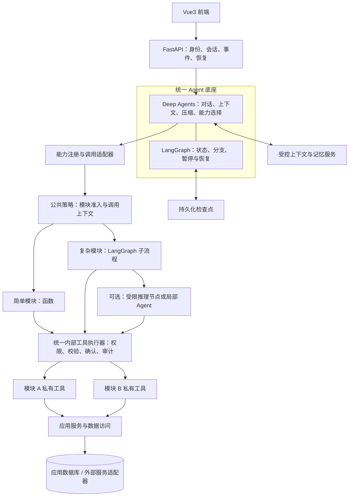
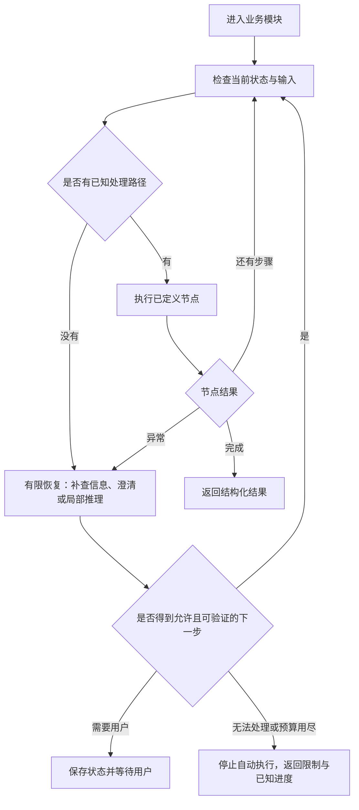

# AI Banking Agent 系统框架

> 版本：v0.3 · 2026-09-18
> 状态：框架设计稿；统一 Harness 方向已确认，本文补充业务内部流程与私有工具的适配方案，尚未实现或验证。
> 读者：项目负责人、底座开发者、各业务线开发者。
> 范围：框架、扩展方式、安全边界和团队接口；不定义具体银行业务流程、额度规则或场景交付范围。
> 本文为独立新版架构文件。原 `technical-architecture.md` v0.2 及已有 HTML、JSON、diagrams 文件保留原样，便于对照；本文不代表这些旧材料已经同步更新。

## 1. 框架决定

采用 **Deep Agents Harness + LangGraph 运行引擎 + 可插拔业务模块 + 统一安全执行入口**。

Harness 可以理解为 Agent 的公共工作底座：模型如何调用、对话如何管理、历史如何压缩、工具如何接入，都由这一层统一组织。LangGraph 是底下负责状态、分支、暂停与恢复的运行引擎。[官方框架定位](https://docs.langchain.com/oss/python/deepagents/overview)

业务模块对外提供稳定的能力入口，内部可以是普通函数、带分支的流程图，或按需使用的局部 Agent。主 Agent 不需要了解每条业务线的所有步骤和内部工具。

| 决定 | 当前选择 | 目的 |
|---|---|---|
| 部署结构 | 一个模块化 Python 后端，前端 Vue3，接口 FastAPI | 降低启动、调试和联调成本 |
| 公共 Agent 底座 | Deep Agents，统一创建和配置 | 复用上下文管理等现成能力 |
| 流程引擎 | LangGraph | 承载需要明确分支与暂停恢复的业务模块 |
| 扩展单元 | 业务能力包 | 团队按模块独立开发 |
| 工具组织 | 对外能力目录 + 模块内部工具目录 | 控制主 Agent 的工具数量和权限范围 |
| 数据格式 | 后端 Pydantic，导出接口格式供前端使用 | 统一输入、输出和错误格式 |
| 数据存储 | SQLite/SQLModel 起步；运行状态和记忆分别接持久化后端 | 单机演示方便，存储职责清楚 |
| 通信 | 普通 HTTP 请求 + SSE 事件 | 支持消息、进度和等待用户的状态 |

团队并行开发通过模块接口实现。运行时是否同时执行多个任务，是另一项选择；首版不以多 Agent 并发为前提。

## 2. 整体结构



图中的“统一执行器”是公共代码组件，各模块都调用同一套实现，不要求新增网络服务。它既保护主 Agent 直接使用的工具，也保护子流程和局部 Agent 使用的内部工具。

## 3. 复杂业务怎样接入

### 3.1 三种模块实现，共用一个对外契约

| 实现方式 | 适用特点 | 对外表现 |
|---|---|---|
| 函数模块 | 一次明确调用即可完成 | 一个能力入口，返回统一结果 |
| 流程模块 | 多步骤、多条件分支，需要暂停、恢复或检查状态 | 同样是一个能力入口，内部使用 LangGraph 子流程 |
| 流程 + 局部 Agent | 某一段需要理解非标准信息或选择后续动作 | 外部接口不变，只在内部特定节点使用模型 |

复杂银行能力优先采用流程模块。已知条件和允许的路径由代码表达；需要语言理解或探索的部分才交给模型。不要要求每个模块都复制一套 Router、Planner、执行器和记忆系统。

注册中心记录模块类型，但主 Agent 看到的是能力名称、用途、输入要求和可返回的状态。模块以后由函数升级为子流程，只要外部契约兼容，主 Agent 和前端就不必跟着重写。

### 3.2 已知分支与意外情况分开处理



上图是框架模式，不是具体银行 SOP。恢复环节必须有结束条件：最大步骤数、重试次数、运行时间和模型调用预算由底座提供，模块只能在批准范围内配置。

| 异常类别 | 框架行为 |
|---|---|
| 输入不足或含糊 | 返回澄清请求，保存当前任务位置 |
| 已知条件不满足 | 走已定义分支，返回可解释状态 |
| 临时技术故障 | 只对明确可安全重试的动作做有限重试 |
| 写操作结果不确定 | 查询和核对原操作；不能把超时直接当失败重做 |
| 未知情况 | 进入有限恢复；无法确定时停止或请求人工处理 |
| 权限拒绝 | 停止相应动作；不得通过换工具、换模块或换 Agent 绕过 |

“人工处理”在首版表示前端展示需要用户决定或暂不支持，并不假设已有人工客服系统。

### 3.3 与 Harness 的具体衔接

默认通过公共调用适配器，把流程模块包装成主 Agent 可调用的能力工具；适配器负责输入输出转换、执行上下文、事件和恢复关联。这样可以保留强类型参数，也便于集中检查模块准入。

Deep Agents 另有 `CompiledSubAgent` 接口，可接入已经编译的 LangGraph 图。只有需要独立上下文委派时才采用这一形式；它是可选接入方式，不要求所有复杂模块都变成自主 Agent。自定义图的状态格式与 Harness 消息接口仍需适配。[官方子 Agent 接入](https://docs.langchain.com/oss/python/deepagents/subagents)

函数包装不等于恢复能力已经完成。首轮必须实测：内部暂停能否传至前端、重启能否恢复原任务、是否重复执行。工具间接调用的子图不一定能被通用图检查器完整展示，所以模块必须主动发出进度事件。[LangGraph 子图文档](https://docs.langchain.com/oss/python/langgraph/use-subgraphs)

## 4. 业务内部工具怎样组织

采用两级目录，统一执行策略。

| 目录 | 谁能看到 | 内容 |
|---|---|---|
| 对外能力目录 | 主 Agent | 每个业务模块的少量公开入口 |
| 模块内部工具目录 | 所属流程或获准的局部 Agent | 查询、校验、计算、外部服务调用等内部能力 |

工具先经过统一注册和安全包装，再交给模块使用；不能同时向模型提供未包装的原始工具。内部工具无需都展示给主 Agent。

普通格式转换、纯计算等内部辅助函数，不必全部注册成模型工具。但涉及数据访问、外部调用或状态修改的能力，必须通过公共授权服务或受保护工具入口。

每个工具的注册信息包含：唯一名称、所属模块、输入输出格式、需要的权限、是否有副作用、确认策略、超时、重试条件、结果敏感等级。模块提供声明，中央策略做最终裁定；未声明权限与副作用的工具不能自动启用。

跨模块协作只调用公开能力接口，或者使用明确划为共享基础能力的服务。模块 A 不直接拿模块 B 的私有工具、数据库表或可变状态。框架禁止循环委派并限制调用深度。

首版这些都是项目内 Python 模块，不强制 MCP 化，也不开放用户上传可执行插件。模块隔离是代码和权限设计上的边界，不能宣称它等同于操作系统沙箱。

## 5. 上下文、记忆与执行状态

| 信息 | 管理者 | 生命周期与访问范围 |
|---|---|---|
| 主对话历史与摘要 | 公共 Harness | 按用户与会话隔离 |
| 模块任务状态 | LangGraph 检查点 + 模块状态格式 | 按任务保存，用于暂停恢复 |
| 局部推理上下文 | 底座提供的统一 Agent 创建器 | 只传入本任务需要的信息，返回必要结果 |
| 临时大段材料 | 受限虚拟文件空间 | 按用户、会话或任务隔离，有清理规则 |
| 用户长期偏好 | 受控记忆服务 | 按用户隔离，校验后写入，可查询和删除 |
| 系统规则、Skills | 团队维护 | Agent 只读，不能用工具结果覆盖 |
| 权限、确认记录和业务事实 | 应用服务与数据库 | 确定性记录，不以聊天摘要替代 |

Deep Agents 的历史压缩与大结果移出上下文可以复用；模型上下文上限和压缩阈值需按实际供应商配置。自定义流程不会因为处在 Deep Agents 下面就自动获得所有上下文中间件；需要局部 Agent 时，统一由底座创建并显式装配。[上下文机制](https://docs.langchain.com/oss/python/deepagents/context-engineering)、[定制与中间件](https://docs.langchain.com/oss/python/deepagents/customization)

用户长期记忆由公共服务写入，业务模块不自行修改全局记忆文件。框架的文件式记忆加载可用于团队维护的只读规则；结构化用户偏好通过受控接口读取。持久化 Store 需选定具体实现，`InMemoryStore` 仅用于临时演示，不满足重启恢复。[记忆机制](https://docs.langchain.com/oss/python/deepagents/memory)、[存储后端](https://docs.langchain.com/oss/python/deepagents/backends)

默认每次新业务调用使用独立的子任务状态；澄清、确认和恢复继续原任务，而不是新建另一个任务。只有明确需要业务专属的多轮累积状态时，才配置长期子会话。

框架维护 `thread_id`（会话）、`task_id`（业务任务）、`invocation_id`（调用）与检查点位置的关联。用户身份来自服务端登录上下文，不能由模型填入。相同会话/任务的修改与恢复请求先串行处理，防止两个请求同时推进一个执行位置。

## 6. 安全边界

安全由底座统一提供，模块负责调用。主 Agent 能选择能力，但不能修改授权规则。

| 边界 | 框架必须保证 |
|---|---|
| API → 会话与恢复 | 校验登录身份、会话归属、任务归属及恢复请求 |
| Harness → 业务模块 | 只开放准入的能力，传递服务端可信上下文 |
| 业务模块 → 内部工具 | 按每次实际调用校验权限、参数和必要确认 |
| 工具 → 应用服务 | 状态修改在服务入口再次验证关键条件；恢复重放不能产生重复副作用 |
| 工具结果 → 模型 | 限制字段与大小，标记来源；自由文本不获得修改权限或规则的资格 |
| 模型 → 记忆 | 受控写入，防止外部内容变成长期系统指令 |
| 模型 → 前端 | 只发送允许展示的内容与业务事件，过滤内部压缩和推理消息 |

不能因为外层“业务模块调用”获准，就放行内部全部动作。内部工具即使不向主 Agent 展示，仍然必须经过同一安全执行器。敏感动作的确认绑定具体调用和参数；参数改变后重新检查，不能依赖自然语言中的“之前已经同意”。

Deep Agents 的人工确认机制负责暂停与恢复，项目负责身份与授权判定。其文件权限设置主要覆盖内置文件工具，不自动保护业务工具；因此不能把文件权限配置当作整个系统的权限系统。[人工确认](https://docs.langchain.com/oss/python/deepagents/human-in-the-loop)、[文件权限范围](https://docs.langchain.com/oss/python/deepagents/permissions)

首版仅开放受限虚拟文件空间，不接通用 Shell 或任意代码执行。默认通用子 Agent、动态创建子 Agent 与递归委派关闭；后续业务确有需要时，启用显式登记的局部 Agent，并明确指定工具清单、预算与安全配置。

局部 Agent 的自定义中间件和自定义编译图不能假设自动继承主 Agent 的安全设置。公共创建器与工具执行器承担一致性检查；模块不能自行创建一个不受管理的 Agent。

审计记录调用链、模块、工具、规则判定、状态变化和必要结果引用；敏感数据在进入模型或日志前最小化处理。“只追加日志”是应用约束，本文不据此宣称已实现防篡改。

## 7. 业务模块的最小对接契约

以下是项目约定，不是 Deep Agents 自动提供的插件协议。先定义契约，再独立开发模块。

| 项目 | 模块需要交付什么 |
|---|---|
| 模块清单 | 名称、版本、用途、负责人、实现类型及依赖 |
| 公开入口 | 主 Agent 可以调用的能力及输入输出格式 |
| 私有工具 | 内部工具清单与风险声明；纯辅助函数可留在内部 |
| 状态格式 | 需要保存的数据、任务状态和恢复所需信息 |
| 交互请求 | 需要用户澄清、批准或选择时的结构化内容 |
| 测试 | 正常、分支、暂停恢复、异常和权限拒绝的独立用例 |

统一结果至少包含 `task_id`、`status`、必要数据或结果引用、可展示说明、错误码及允许的后续动作。大段内部材料不直接拼回主对话。

建议状态：`running`、`waiting_input`、`waiting_approval`、`succeeded`、`partially_succeeded`、`failed`、`cancelled`、`needs_attention`。状态由执行结果确定，不能由模型自由编造；其中部分成功由模块在确有多项结果时使用。

公开 API 统一使用“开始、补充输入/恢复、查询状态、取消”的语义。取消请求只表示请求停止；最终是否已取消或仍需核对，由任务执行状态决定。

底座把 LangGraph 的暂停事件转换为前端交互请求；用户回答交回原任务。不要把暂停捕获成普通失败，也不要把 `waiting_approval` 当成能力已完成。恢复定位信息由服务端持有，客户端只提交获准的回答或操作。

SSE 事件统一包含事件编号、会话、任务、模块和事件类型。进度与结果可见，内部模型思考与压缩内容默认不可见。断线后用任务状态查询补齐，事件重放按实现能力提供，不假设 SSE 库自动保存历史。

## 8. 团队并行开发边界

| 工作块 | 负责内容 | 对外提供 |
|---|---|---|
| Agent 底座 | Harness 创建、模型适配、上下文、模块接入、检查点与恢复 | 公共运行接口、模块适配器 |
| 安全与记忆 | 策略、统一工具执行器、用户隔离、记忆读写、审计 | 所有模块共用的服务 |
| 业务模块 | 公开能力、内部流程、私有工具、状态与测试 | 遵守统一契约的能力包 |
| 前端/API | 身份、任务交互、事件展示、恢复和取消 | 稳定的用户交互协议 |

业务开发者可以先用假的模型返回和模拟工具，独立验证流程，再接入真实 Harness。底座提供同一个模块模板和测试入口，避免各业务线重新设计恢复和安全机制。

建议的代码组织如下，仅描述目录边界，本次不创建代码骨架：

```text
backend/app/
  api/                  请求、身份、事件与恢复接口
  agent_platform/       Harness、模型适配、注册中心、流程适配器
  security/             策略、工具执行器、确认与审计
  memory/               上下文后端、长期记忆接口与用户隔离
  modules/
    <module_name>/
      manifest          模块说明、公开入口与依赖
      contracts         输入、输出、状态
      workflow          可选：带分支的流程图
      tools             模块私有工具
      reasoning         可选：局部推理节点
      tests             模块独立验证
  services/             可复用的应用能力
  storage/              数据访问、迁移、持久化适配
```

目录名是建议；模块内的文件形式在接口设计时确定。内部模块靠显式登记装配，首版不做运行时上传、自动安装或热更新。

## 9. 框架验证范围与待定项

本轮交付文档，不表示下面的检查已经通过。下一步用无真实银行含义的演示模块验证公共机制。

| 验证项 | 通过标准 |
|---|---|
| 模块接入 | 函数模块与流程模块使用同一外部结果格式，互换时前端无需改动 |
| 私有工具 | 主 Agent 不获得私有工具；所属模块能使用获准工具，其他模块越权调用被拒绝 |
| 多分支 | 可控条件分别进入不同分支，能追踪实际路径 |
| 未知异常 | 有限恢复后结束或请求用户，不能无限循环、擅自扩大权限 |
| 内部暂停与恢复 | 子流程可暂停，重启后恢复同一任务；恢复不会重复产生已完成的副作用 |
| 安全覆盖 | 外层调用获准后，内部未获准动作仍被拦截；局部 Agent 不能绕过 |
| 上下文与记忆 | 长对话触发压缩，任务状态保持正确；用户之间不串数据；持久化记忆重启可读 |
| 交互与事件 | 前端能显示进度、等待与完成；断线后可查询状态；内部压缩文本不外露 |

实现前需要确定：Deep Agents/LangChain/LangGraph 的兼容精确版本、持久化 Store 的具体实现、模块输入输出字段、检查点命名与恢复映射。选定模型还要验证工具调用、结构化输出、流式输出和压缩能力；OpenAI 兼容端点不代表各项行为完全一致。

SQLite 可继续作为单机应用数据库和检查点起点；长期记忆的 Store 实现另行验证。不要把“都能放 SQLite”写成现成组件已经全部接通，也不为此提前搭建大型基础设施。

## 10. 与旧版的变化

| v0.2 | v0.3 |
|---|---|
| 自建统一 Plan-and-Execute 循环 | Deep Agents 负责公共 Harness，避免重复搭建上下文循环 |
| 每个场景复制相同编排结构 | 每个模块按复杂度选择函数、子流程或局部推理 |
| 平铺银行工具 | 主 Agent 的能力入口与业务私有工具分层 |
| 安全描述主要围绕入口与计划审查 | 模块准入与每次内部工具执行都受控 |
| 记忆、压缩与检查点的职责混在一起 | 对话、模块执行状态、长期记忆和业务事实分别管理 |
| Python 后端仍写 Zod 校验 | 后端 Pydantic，前端使用导出的契约 |
| 单 Agent 被理解为不能有任何局部推理 | 默认一个主 Agent；仅按需启用受控局部 Agent |

历史：v0.1（2026-09-15）为 Pi/AgentKernel 初稿；v0.2（2026-09-17）切换 LangGraph；v0.3（2026-09-18）确立统一 Harness 与模块化业务流程。旧版保留作历史参考，具体业务需求和排期不在本轮重新制定。
