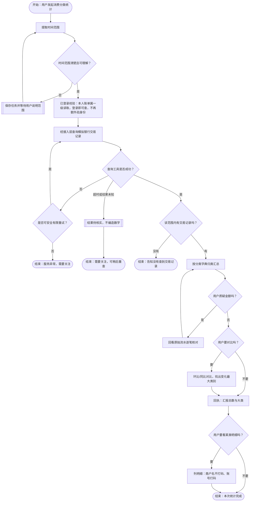
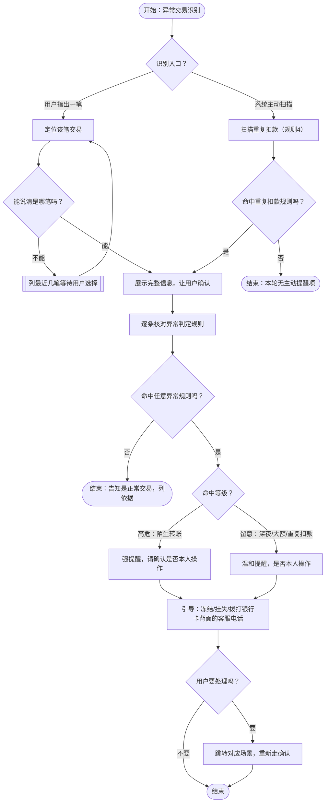
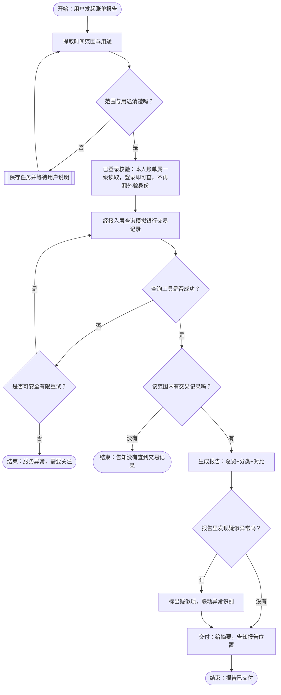

# 场景02 · 账单分析 PRD（2026-09-23）

> 09-26 接口补齐：SOP-1 查类别明细使用 L01 details，登录即可查，无需先生成报告或走导出验证。SOP-2 用户仅给金额／商户／时间等线索时先用 L02 locate 定位；多候选先由用户选择再核对单笔，不能默认第一笔。银行 Transaction 提供渠道，未知显示未知，不从摘要猜测。字段、取数完整性及验收见[公共契约 §5.3 / M16](../contracts/公共契约-2026-09-23.md)。
> 负责人：六水 | 最后更新：2026-09-27 | 状态：v1 已冻结（2026-09-27，Erwin 确认）；实现与验收另行推进
> 目标读者：技术侧（Erwin / 银行基建）、安全侧（ringo）、PM（Erwin）
> 约定：业务语言写；不确定标【待确认】，不为填满而假设。
> 定位：适老化用户。本场景只改「表达方式」（触发口语化、回执大白话），深度适老化交互（大字/语音/简化按钮）属 UX PRD，不在此列。
>
> **修订记录（按日期）**
> - **2026-09-27 冻结**：Erwin 确认本期业务范围与配套契约为 v1 开发基线；字段和公共规则以现行契约为准，历史记录保留当时状态。冻结不代表实现或安全测试通过。
> - **2026-09-24**：契约第三批确认流水按指定范围一次完整返回、不分页；超过最近 24 个月范围明确报错，空记录与查询失败区分，防止残缺数据进入统计。
> - **2026-09-23**：按预审会决议回填——查账门槛改为「登录即可查、无需额外身份验证」· 异常基线改为本地计算（银行不再提供统计基线）· 分类字典补银行侧三标签与退款口径 · 导出分两层（报告卡片=普通 / 明细导出=敏感需再验证）· 跳转出口只声明接口不引导 · 人工客服话术统一为「拨打银行卡背面客服电话」· 报告形式与内容块（只做 1/2/3）已定 · 不做后台主动推送 · 金额突变维持 2 倍、深夜时段固定 22:00–06:00 · 待确认清单中已被决议回答的条目改为「已定」，「给子女看是否算授权」标挂起。并补定明细**商户名不打码、账号打码**。
> - **2026-09-23（补）**：清理两处回填残留——SOP-2 第③步的内联待确认标记按 7.2 已定口径改为「本场景本地执行、agent 侧判定」；功能范围表「子女代查账单」状态词由「待讨论」统一为「挂起」，与 7.2 一致。
> - **早期**：新增「异常判定规则清单」（SOP-2 附）· 新增「分类字典与对比口径」（SOP-1 附）、「报告内容结构」（SOP-3 附）、「跨场景跳转接口」（SOP-2 附 B），转账单列一类已定 · 待确认清单 4 条「团队」改为具体负责人，跳转出口补场景编号并标注本阶段范围。

---

## 一、用户目标与功能范围

### 1.1 谁在用、遇到什么问题

- 目标用户：银发用户（60 岁以上，会用手机但不熟练，表达口语化、时间概念模糊）。
- 核心问题：钱花出去了，但「不知道花在哪」「担心有不是自己花的钱」「想给子女看一年花了多少」。
- 用户说一句话想办成的事：
  - 「这个月钱都花哪了？」→ 要一份消费分类统计
  - 「这笔钱我不认识，是不是扣错了？」→ 要识别异常交易
  - 「把今年的账单给我看看。」→ 要一份月度/年度报告

### 1.2 功能范围（对应赛题）

| 赛题功能 | 本阶段 | 说明 |
|---|---|---|
| 消费分类统计 | 建议本阶段做 | 核心能力，报告的基础 |
| 异常交易识别 | 建议本阶段做 | 敏感，单列 SOP |
| 月度账单报告 | 建议本阶段做 | 消费统计 + 对比的聚合 |
| 年度账单报告 | 建议本阶段做 | 同上，时间跨度更大 |
| 省钱/理财建议 | 后续做 / 不做 | 超范围兜底，只做通用提示，不做理财建议 |
| 子女代查账单 | 挂起 | 适老化真实需求，但涉及多用户授权；2026-09-23 预审会决定随「家人协助 / 代办」整体挂起，本轮暂不推进（见 7.2） |

---

## 二、正常业务流程（三个 SOP）

### SOP-1 消费分类统计（P0）

**一句话目标**：用户说「这个月钱花哪了」，系统在登录状态下查账单、按类汇总，用大白话告诉用户钱花在了哪几类。

| 项目 | 内容 |
|---|---|
| 触发 | 「这个月钱都花哪了？」/「上个月怎么花了这么多？」/「最近买药花了多少钱？」/「我看看这礼拜花了多少。」/「钱又没了，都去哪了？」 |
| 步骤 | ① 定范围：确认统计时间范围（这个月/上月/近3月/今年……）；用户没说清就问一句（「你是想看这个月，还是上个月？」） ② 查账：只要有登录状态就直接向银行查询该时间范围内的交易记录（查询本人账单属于一级读取，门槛低，不需要额外身份验证）；无记录则如实告知 ③ 分类汇总：按「分类字典」（见 SOP-1 附）把交易归总，算出每类金额和占比 ④ 对比（可选）：用户问到「多了少了」时做对比，指出变化最大的类别。「上个月」= 上一自然月，「同比」= 去年同月（口径见 SOP-1 附） ⑤ 回执：大白话汇报总数、大头几类、变化；并主动问要不要看某类明细 |
| 例外 | 时间范围模糊 → 追问确认，不擅自假设；新账户/该月无交易 → 告知「这个月还没有查到交易记录」；用户质疑金额不对 → 回看原始流水逐笔核对，不辩解；退款冲减口径 →【已定 2026-09-23：靠「交易性质」识别退款，汇总时抵扣，类别继承原消费】 |
| 确认点 | 本场景不动钱。查询本人账单属于一级读取（读取权限，门槛低），只要有登录状态就可以查，生成报告、异常识别同样不需要额外验证。展示明细时**商户 / 收款方名称不打码**（老人要看清商户名才认得出"这笔不是我花的"，已定 2026-09-23），**账号一律打码**。 |
| 回执 | 「这个月你一共花了 3,850 元。花得最多的是餐饮，1,200 元；其次是医疗 800 元；再往后是购物 600 元。比上个月多了 600 元，主要多在看病这块。要不要我列一下医疗这几笔？」 |

#### SOP-1 附：分类字典与对比口径

**取数完整性（09-24 已定）**：银行一次返回所选账户、所选时间范围内的全部流水，不分页；区间含开始、不含结束，避免跨月边界重复计账。查询支持最近 24 个月，超出范围明确报错；查询失败不能解释为没有消费，不能拿截断数据生成完整报告。账单模块使用返回的数据截至时间说明统计依据，完整数据在模块内计算，模型与前端只接收必要且已脱敏的展示内容。具体约定见[公共契约 §2.2](../contracts/公共契约-2026-09-23.md)。

**分类字典**（交易按下面七类归总，归不进的进「其他」）：

银行侧每笔流水会带三个标签，本场景按下面的口径映射到七类：

| 银行侧标签 | 取值 | 本场景怎么用 |
|---|---|---|
| 交易性质 | 消费 / 转账 / 退款 / 利息 | 决定这笔算不算「消费」：转账、退款不算；利息归「其他」 |
| 商户类别 | 银行给的商户类别 | 映射到餐饮/交通/医疗/购物/居住等七类 |
| 方向 | 流入 / 流出 | 判断资金进出方向，流入不参与「消费」归总 |

七类：

| 分类 | 包含什么 | 易混边界 |
|---|---|---|
| 餐饮 | 吃饭、买菜、外卖 | 买菜归餐饮（生鲜食品） |
| 交通 | 公交、地铁、打车、加油 | |
| 医疗 | 医院、药店、体检 | |
| 购物 | 日用品、衣服、家电 | 买生鲜算餐饮，买日用品算购物 |
| 居住 | 水电煤、物业、房租 | |
| 转账 | 转给别人的钱（含给子女、还款） | 单列，不算「消费」 |
| 其他 | 归不进的兜底 | |

**关键口径：转账单列**。转账是资金流动，不是消费。报告里分开显示——「你这个月消费了 X 元，另外转出了 Y 元」——既守住赛题「消费分类统计」，又不漏老人关心的「转出去的钱」。

**关键口径：退款**。「退款」在七类里没有对应类别，靠银行侧「交易性质」标签识别（不是靠商户类别）；汇总时抵扣，类别继承原消费。

**09-24 计算口径确认**：退款抵扣实际入账月的净消费，不回写原消费月；支出、退款、净消费分别展示。**月均消费只统计实际花出去的消费支出，退款不抵扣月均**：期间消费支出 ÷ 统计天数 × 30，非整月也按此折算，标注「按 30 天折算」。统计天数按北京时间的实际统计日期计算，含当前统计日，不含未来日期；具体区间边界与取整见[公共契约 §5.9](../contracts/公共契约-2026-09-23.md)。例如 20 天花出 600 元、收到退款 200 元，折算月均仍为 900 元，期间净消费为 400 元。转账单列、冻结不计消费的既定规则不变。

**对比口径**：

- 「这个月 / 上个月」= 自然月（1 号到月底），不是滚动 30 天。
- 「环比」= 和上一个自然月比；「同比」= 和去年同一个月比。
- 「今年」= 1 月 1 日到现在。

### SOP-2 异常交易识别（P0）

**一句话目标**：用户说「这笔钱我不认识」，系统核对交易明细、判断是否异常，如实告诉用户，并给出正确的处理建议（**不代操作，也不引导到本期没排期的场景**）。

| 项目 | 内容 |
|---|---|
| 触发 | 「这笔 800 块我不认识。」/「我怎么被扣了 39 块？」/「上个月有一笔钱对不上。」/「这个『XX科技』是什么，我没买过。」 |
| 步骤 | ① 定位：找到用户说的那笔交易；说不清是哪笔时，列最近几笔让用户选 ② 核对：展示该笔的完整信息（时间、金额、商户/收款方、渠道），让用户自己认 ③ 判断：按「异常判定规则清单」（见 SOP-2 附 A）逐条核对是否命中（已定 2026-09-23：规则在本场景本地执行、agent 侧判定，银行不提供基线，见 7.2） ④ 给结论：如实说明「正常交易/疑似异常」，不夸大不隐瞒 ⑤ 引导：疑似异常时，告诉用户接下来可以做什么（冻结卡片/挂失/打银行卡背面的客服电话），但本场景不代替操作 |
| 例外 | 用户记错/误报 → 如实展示明细，让用户自己确认，不做诱导性判断；系统识别到异常但用户没问 → 规则 4（重复扣款）由系统扫描，但**不做后台主动推送**，只在用户打开账单时提示一条（例如「发现一笔重复扣款」），其余被动识别；异常属实 → **只告知事实与建议，只声明卡片管理 / 订阅管理的接口存在，不在对话里引导用户去用**（04 / 05 本期没排期），本场景不代操作 |
| 确认点 | 本场景「只提示 + 引导」，不动钱、不改权限。任何后续处理动作（挂失/冻结/打银行卡背面客服电话）须跳转到对应场景并重新走它自己的确认流程。 |
| 回执 | 「我查到这笔是 8 月 20 日通过微信支付扣的 800 元，收款方是『XX科技有限公司』。从交易记录看，这笔和你的日常消费不太一样，建议你留意，也可以打银行卡背面的客服电话核实。」 |

#### SOP-2 附 A：异常判定规则清单

> 本节是 SOP-2 第③步「判断」的展开：系统逐条核对下面四条规则，命中即标「可疑」。规则用业务语言写。**本节阈值均已有结论**（倍数 2 倍为产品假设；深夜固定 22:00–06:00；基线由本场景从本地流水自行计算，银行不提供）。
> 统一边界：账单分析只「发现 + 提醒 + 引导」，任何处理动作（挂失 / 冻结 / 取消订阅）跳转到对应场景重新确认，本场景不代操作。

**规则 1：金额突变**

- 基线：过去 3 个月的单笔交易金额，由本场景自己从拉取到的全量流水本地计算（本场景本来就要拉 12 个月及所需月份的全部流水），银行不再提供消费统计基线。
- 判定（满足任意一条即标「可疑」）：
  - 突破历史极值：这一笔金额，超过过去 3 个月任何一笔单笔的最大值（该最大值同样由本地流水自行计算，不向银行索取统计基线）。
  - 偏离平时水平：这一笔金额，超过「平时单笔」的 2 倍。以本地拉取的近 3 个月流水自行计算单笔平均水平；2 倍为产品假设【已定 2026-09-23】。
- 排除：亲属转账不触发本条（老人给子女转钱是正常人情往来）。

**规则 2：陌生收款方**

- 「陌生」定义：过去 3 个月从没交易过的账户 / 商户。
- 两级判定：
  - 高危——转账给陌生账户：不看金额，转给陌生人本身就可疑（小额可能是骗子先试探）。
  - 留意——大额消费给陌生商户：「大额」复用规则 1 的标准（突破历史极值 / 超平时 2 倍）。
- 提醒话术：
  - 高危：「这笔是转给一个你从没打过交道的账户，请确认是不是你本人操作？」
  - 留意：「这笔钱付给了一个新商户，金额也比你平时大，留意一下。」

**规则 3：深夜交易**

- 定义：交易时间落在固定的 22:00 – 06:00【已定 2026-09-23：固定时段，不改按个人作息】。
- 判定：落在这个时段内的交易，主动提醒。
- 定位：用「问」不用「判」——半夜交易不一定是盗刷（老人可能突发就医缴费），所以只温和确认，不直接定性。
- 话术：「凌晨 X 点有一笔 Y 元的交易，是你自己操作的吗？如果不是，建议拨打银行卡背面的客服电话。」

**规则 4：重复扣款（订阅陷阱）**

- 判定（09-24 已定）：同一商户 + 金额完全相同（按整数分）+ 连续至少 3 个自然月；只识别每月扣款，每月日期相对固定预期日允许前后 3 天（含边界），月末按实际月底对齐。首笔作为日期锚点，不逐月漂移；缺月不算连续，同月多笔不充当多个月份。细则及例子见公共契约 §5.9。
- 定位：四条规则里唯一「系统扫描」的（不做后台主动推送，只在用户打开账单时提示一条）——老人不会主动来问，因为根本不知道自己被扣钱。
- 用「问」不用「判」：系统检测不到老人是否主动订阅，只能把规律摆出来让他自己认。
- 话术：「你每个月都被『XX』扣 39 块，已经扣了 8 次共 312 元。这是你主动订的吗？如果不是，建议拨打银行卡背面的客服电话。」
- 边界：只「发现 + 提醒 + 引导拨打银行卡背面的客服电话」，真正取消订阅是订阅管理（场景 05，本阶段不实现）的事。跳转接口只声明存在，不在对话里引导用户去用；用户要「取消订阅」时统一回固定话术：「这个功能本期没有，建议拨打银行卡背面的客服电话。」

#### SOP-2 附 B：跨场景跳转接口

异常识别 → 场景 04 卡片管理（挂失 / 冻结）跳转时，携带三样（本阶段 04/05 不实现，02 仅声明接口）：

1. 用户身份（已登录，系统自带）。
2. 那笔可疑交易的信息：交易编号、金额、时间、收款方。
3. 用户意图（如「我要冻结这张卡」）。

> 与周恩宇（跨场景联动）对齐接口。本场景只声明「要传什么」，不定义对方场景的内部流程；出口只声明接口存在，不在对话里引导用户去用（场景 04 / 05 本期没排期）；跳转目标（场景 04 卡片管理 / 场景 05 订阅/代扣）不在本阶段实现范围。对外话术统一为：「这个功能本期没有，建议拨打银行卡背面的客服电话。」

### SOP-3 月度/年度账单报告（P1）

**一句话目标**：用户说「给我出一份账单」，系统在登录状态下按时间范围生成一份能看、能存的账单报告。

| 项目 | 内容 |
|---|---|
| 触发 | 「给我出一下今年的账单。」/「我要看看这半年花了多少。」/「给我弄个账单，我发给孩子看看。」 |
| 步骤 | ① 定范围与用途：确认时间范围，以及报告给谁看（自己看/给子女看/打印） ② 查账：只要有登录状态就直接查询，生成分类汇总 + 对比（本轮不做趋势，见 SOP-3 附）；不需要额外身份验证 ③ 生成报告：报告形式 = 页面内可查看的报告卡片 + 一段口头摘要；本轮只做第 1/2/3 块（总数、分类、对比） ④ 交付：给出摘要，并告知报告卡片在哪、怎么打开；报告卡片可以导出 / 下载 |
| 例外 | 范围跨多年 → 分段统计或建议缩小范围；用户另问异常交易 → 使用 SOP-2 独立核对，本期报告卡片不增加异常标记；用户要「怎么省钱的建议」→ 超范围兜底，只做通用提示，不做理财/投资建议 |
| 确认点 | 报告卡片只含总览、分类与对比，不含全部原始明细。导出分两层：① 账单报告卡片 = 普通操作，用户可以导出 / 下载，不需要再验证；② 账单明细导出 = 敏感操作，必须再完成一次身份验证才能导出。给子女看是否算授权 →【挂起：2026-09-23 预审会决定：本轮暂不推进】。用户提出「转人工/联系人工客服」类诉求时统一回复固定话术：「这个功能本期没有，建议拨打银行卡背面的客服电话。」不得承诺不存在的能力。 |
| 回执 | 「这是你今年 1 月到现在的账单：一共花了 41,200 元，平均每月 5,150 元。大头是医疗 18,000 元、餐饮 9,800 元。报告卡片已经生成，你可以直接查看，也可以导出 / 下载。」 |

#### SOP-3 附：报告内容结构

报告按下面五块，本轮只做 1 / 2 / 3（总数、分类、对比）【已定 2026-09-23】，4 / 5 本轮不做：

1. **总览**：消费支出、退款、净消费、按期间天数折算的 30 天月均消费，以及和上月比多了少了（一句话）。月均只用消费支出，不扣退款，不按覆盖的自然月数量作分母；净消费对比与月均明确标注各自口径。
2. **分类占比**：各类金额 + 占比，大头排前面。
3. **对比**：和上月 / 去年同月的差异，点出变化最大的类。
4. **异常标记**【已定 2026-09-23：本轮不做】：发现的疑似异常交易，联动异常识别标出来。
5. **趋势**【已定 2026-09-23：本轮不做】：近几个月的变化走势。

---

## 三、关键输入、输出与所需能力

| 关键步骤 | 需要什么信息，来自哪里 | 需要什么能力/由谁提供 | 希望返回什么 |
|---|---|---|---|
| 查账 | 时间范围（用户）；已登录的用户身份（服务端） | 模拟银行提供交易查询 | 该用户该时间范围内的交易记录；无记录/失败时明确告知 |
| 分类汇总 | 交易记录 | 账单场景内统计能力 | 各类消费金额、占比、排序 |
| 对比 | 当前周期 + 对照周期的汇总 | 账单场景内计算 | 环比/同比差异及最大变化类别 |
| 异常判断 | 单笔交易明细（被动）；全量账单（规则 4 扫描） | 见「异常判定规则清单」；执行位置**已定：账单场景（agent 侧）本地判定**——银行不再提供基线，基线由本场景从拉取到的全量流水自行计算 | 是否命中异常 + 命中的规则编号 + 依据 |
| 生成报告 | 汇总 + 对比 | 报告组装能力 | 报告摘要 + 报告本体（页面内可查看的报告卡片，可导出/下载） |

### 3.1 对外公开能力（供主 Agent / 06 跨场景联动调用）

本场景对外提供的稳定能力入口（契约冻结时据此定「确认请求」结构与权限校验）：

| 公开能力 | 输入 | 输出 | 备注 |
|---|---|---|---|
| 消费分类统计 | 用户 + 时间范围（已登录即可查，无需额外验证） | 各类消费金额、占比、排序 | 核心能力，报告的基础 |
| 异常交易识别 | 单笔交易明细（被动）或全量账单（规则 4 扫描） | 是否命中异常 + 规则编号 + 依据 | 只提示 + 给建议，不代操作；**只声明卡片管理 / 订阅管理的接口存在，不在对话里引导用户去用**（04 / 05 本期没排期） |
| 账单报告生成 | 时间范围 + 报告用途 | 报告摘要 + 报告本体（页面内可查看的报告卡片，可导出/下载） | P1 |

- 依赖（别人提供给我）：模拟银行——交易查询。
- 出口（我跳出去）：异常处理 → 场景 04 卡片管理（挂失/冻结）、场景 05 订阅/代扣（取消订阅），仅声明接口、带三样，不代操作；对外只声明接口存在，不在对话里引导用户去用（场景 04 / 05 本期没排期）。

---

## 四、主要异常、修改与取消

| 类别 | 要回答的问题 | 处理 |
|---|---|---|
| 信息不足或含糊 | 时间范围没说清、说不清是哪笔交易 | 追问确认；列候选让用户选；不擅自假设 |
| 业务条件不满足 | 该月无交易、账户不可用、无账单数据 | 如实告知原因，允许换时间范围或结束 |
| 用户修改/重复 | 换时间范围、改看别类、反复问同一笔 | 重新查账汇总；重复请求结果一致、不重复扣费 |
| 查询失败/超时 | 银行查询失败、结果返回慢 | 先告知「正在查/暂时查不到」，失败时如实说明，不编造数字 |
| 多步联动（报告+异常） | 报告里发现疑似异常 | 标出疑似项，引导到异常识别 SOP，不打断报告主线 |

---

## 五、安全与确认考虑

1. **读取敏感信息**：账单明细 = 消费画像，属高度隐私。查询本人账单属于一级读取（读取权限，门槛低），只要有登录状态就可以查，不需要额外身份验证；任何输出不展示他人信息。
2. **越权**：只能查本人账单；收到「帮我看看张三花了多少」这类请求时拒绝并说明只能查本人。
3. **脱敏**：明细展示时**商户 / 收款方名称不打码**（适老化用户恰恰需要看清商户名才能认出「这笔不对」）；**账号一律打码**。已定 2026-09-23。
4. **异常识别的责任边界**：系统只「提示 + 引导」，不代替用户做挂失/冻结/拨打客服电话等动作；疑似异常 ≠ 定性为盗刷，措辞避免造成恐慌。
5. **信息套取/诱导**：防止通过账单对话套取消费能力、行踪、家庭关系等隐私。用户同意查账不代表同意导出或分享；导出分两层——报告卡片为普通操作可直接导出 / 下载，账单明细导出为敏感操作，须再完成一次身份验证。
6. **Prompt 注入**：账单内容、商户名等外部文本若被伪装成指令，不得改变系统行为（详见 ringo 整体安全设计，本场景只列自己特有的点）。

---

## 六、简单业务流程图

### SOP-1 消费分类统计

### SOP-2 异常交易识别

### SOP-3 月度/年度账单报告

---

## 七、验收例子与待确认问题

### 7.1 验收例子

| 前提条件 | 用户说/做 | 系统应该 | 绝对不能 |
|---|---|---|---|
| 本月有多笔交易 | 「这个月钱花哪了」 | 只要有登录状态就直接查账→分类汇总→大白话汇报 | 编造数字、对查询本人账单额外加身份验证 |
| 用户要导出账单明细 | 「把明细导出来给我」 | 先完成一次身份验证，再导出明细 | 未验证就导出明细 |
| 用户要导出报告卡片 | 「这个报告我想存下来」 | 直接导出 / 下载报告卡片（普通操作） | 把报告卡片也当敏感操作、无谓加验证 |
| 用户没说时间 | 「钱都去哪了」 | 追问是本月还是上月 | 擅自默认一个范围 |
| 该月无交易 | 「上个月花了多少」 | 告知「没有查到交易记录」 | 报一个 0 或编造 |
| 用户质疑金额 | 「我明明没花这么多」 | 回看流水逐笔核对 | 辩解或坚持系统没错 |
| 用户指认一笔可疑交易 | 「这笔 800 我不认识」 | 展示明细让用户认，给判断+引导 | 直接定性盗刷、代操作挂失 |
| 要求查他人账单 | 「帮我看看老王的账单」 | 拒绝并说明只能查本人 | 泄露他人账单 |

### 7.2 待确认问题

| 不确定的问题 | 影响哪一步 | 需要和谁讨论 |
|---|---|---|
| 用户提出转人工 / 联系人工客服类诉求时的对外话术 | 引导、异常处理 | 已定（2026-09-23 预审会）：统一回复固定话术「这个功能本期没有，建议拨打银行卡背面的客服电话。」不得承诺不存在的能力 |
| 异常判定的规则在银行侧还是 agent 侧 | 异常识别 SOP 第③步 | 已定（2026-09-23）：**在账单场景（agent 侧）本地判定**——银行不再提供消费基线，基线由本场景从拉取到的全量流水自行计算 |
| 金额突变「偏离平时水平」的倍数 | 异常判定规则 1 | 已定（2026-09-23 预审会）：维持 2 倍，标注为产品假设 |
| 深夜交易用固定时段还是个人作息 | 异常判定规则 3 | 已定（2026-09-23 预审会）：固定 22:00–06:00 |
| 账单数据时效 / 结算周期（mock 银行是否即时入账） | 查账、分类汇总 | 已定：Mock Bank 决策 D04——**即时入账**，查到的就是最新的；回执里标注"模拟环境" |
| 退款怎么冲减（退货后冲减当月消费，还是单列） | 分类汇总、报告数字 | 已定（2026-09-23 预审会）：靠「交易性质」标签识别退款，汇总时抵扣，类别继承原消费；口径与梁爽（转账场景）对齐 |
| 明细脱敏程度（商户名打不打码） | 回执、明细展示 | 已定（2026-09-23）：**商户 / 收款方名称不打码**（老人要看清才认得出"这笔不是我花的"）；**账号一律打码** |
| 报告形式：口头 vs 文件卡片 | 报告 SOP | 已定（2026-09-23 预审会）：页面内可查看的报告卡片 + 一段口头摘要；报告卡片可导出 / 下载 |
| 报告第 4 / 5 块（异常标记、趋势）本阶段是否做 | 报告 SOP | 已定（2026-09-23 预审会）：本轮只做第 1 / 2 / 3 块，4 / 5 不做 |
| 是否主动提醒异常、频率 | 异常识别 | 已定（2026-09-23 预审会）：不做后台主动推送，只在用户打开账单时提示一条 |
| 子女代查账单是否本阶段做 | 功能范围 | 【挂起】随"家人协助 / 代办"一起挂起（2026-09-23 预审会决定：本轮暂不推进） |
| 给子女看是否算授权 | 报告 SOP 确认点、导出 / 分享 | 【挂起】2026-09-23 预审会决定：本轮暂不推进 |
