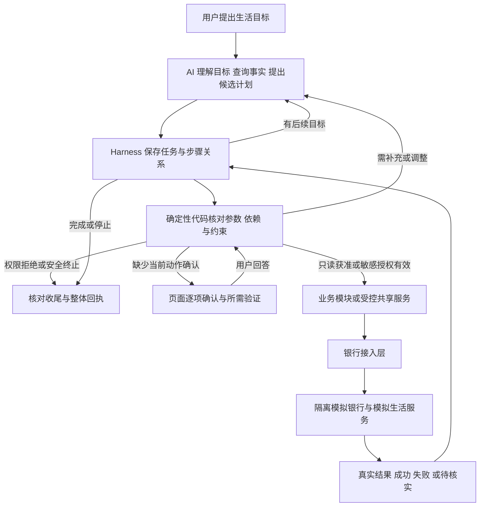

# 06 跨场景联动 · PRD

**最后更新**：2026-10-24

**本阶段业务负责人**：Erwin（2026-10-24 起承接 v0.5 包 03，包 05 E2E 同时转派）；长期目录归属周恩宇（Ethan）不因本阶段承接自动改变。领取与实现状态见项目跟踪；需求文档由 PM 授权 Codex 整理

**状态**：三个生活场景已由 PM 确认；本稿为重写后的需求稿，新增公共约定待按契约流程收口。场景确认、文档编写、业务实现和 E2E 验收分别记录。实际交付以[项目跟踪](../01-项目跟踪.md)及[v0.5 完成情况](../versions/v0.5.0/completion.md)为准。

**修订记录**：

- **2026-10-24（票 01 业务裁定）**：Erwin 确认同账户一次一份联动资金安排（D1），及部分完成后停止的结果（D2）；详见[裁定记录](../../.scratch/v05-cross-platform/01-decision.md)。业务规则已定，公共字段/安全确认、模型实现及 E2E 尚待完成。

- **2026-10-24（规格与拆票）**：PM 后续授权推进并确认顺序及拆分；[共享规格](../../.scratch/v05-cross-linkage/spec.md)、[六包与 21 张独立票](../../.scratch/v05-cross-linkage/ticket-proposal.md)已发布。以下“本轮不拆票”指此前 PRD 重写批次；当前仍未启动代码/评测，未代各负责人接包或确认冻结契约。

- **2026-10-24**：PM 确认“养老金到账后的本月安排、找出并减少不必要开销、家人生日安排”三个目标，要求重写 PRD，验收明确为 E2E；补充 AI 自主规划、Harness 承接与确定性业务流程的职责边界。原 A/B/C 的保留与重组见 §5.3。本轮不写代码、不拆实施票、不直接修改冻结契约。
- **2026-09-27**：原 A/B/C 方案冻结；冻结不代表实现或安全测试通过。
- **2026-09-26**：明确预算采用、版本与占用规则，以及任务结束仅释放未消费冻结的限定授权。
- **2026-09-23～24**：明确联动只做编排、逐项确认、转账复用公开能力；生日资金顺序为冻结预算→下单→分笔核销→释放差额，订单与付款结果分开记录。这些既有业务底线继续适用，字段以公共契约为准。

## 1. 概要与成功标准（Executive Summary）

### 1.1 要解决的问题

银发用户往往知道自己想办成什么，却不知道要先查哪张账单、停哪项代扣、留多少钱、转几笔钱或预订哪些服务。用户应能先说生活目标，由系统补齐信息、提出方案并协助办理，遇到变化时继续处理原目标。

举办方的跨场景示例为“识别生日需求，锁定资金并自动完成鲜花、蛋糕等服务预订”。官方总体要求强调理解金融意图、自主规划与执行；并未要求每个联动场景都调用全部模块。依据：[本地官方资料](../../官方资料/参赛规则与提交要求.md)、[官网赛题说明](https://fintechathon.g-ican.com/)（2026-10-24 核对）。

本产品据此选择三个完整生活目标。联动是编排层，组织转账、账单、订阅及获准生活服务；每项业务仍由原模块或受控服务办理。**AI 负责想办法，Harness 负责承接任务，确定性程序与银行负责守规则和执行。**

### 1.2 当前范围

| 场景 | 用户想办成的事 | 需要协调的能力 | 完成的含义 |
|---|---|---|---|
| XL-P 养老金到账后的本月安排 | 核实入账，处理不用的代扣，留好本人确定的生活费，安排剩余资金 | 账单、订阅、转账、受控账户事实 | 按最终确认方案完成所选退订和转账，说明本次留存安排及仍需留意的扣费 |
| XL-S 找出并减少不必要开销 | 弄清钱花在哪里，处理本人不再使用的自动扣费 | 账单分析、签约查询、订阅退订 | 说明支出变化的证据，完成用户选定的可退订项；不能处理的项目有原因和下一步 |
| XL-B 家人生日安排 | 在预算和送达要求内准备礼物或服务 | 可选账单/已采用预算、商品与订单、资金冻结/核销/释放 | 所选服务在模拟环境中预订并付款，未消费冻结已释放；订单、资金及未完成事项可核对 |

范围是上述目标及其必要变体，不是任意任务执行器。生日场景仍在本期需求内；外部服务与资金能力缺失时标记依赖阻塞，不以只推荐商品或普通转账替代其验收。

### 1.3 成功标准

1. 三个场景分别完成一条真实模型、真实页面、HTTP、隔离模拟银行贯通的正常路径，并覆盖各自关键异常；步骤与记录入口见 §3.3。
2. 相同目标改变表达、对象、预算或可用服务后，系统能调整必要步骤；用户无需照固定脚本说话，也无需逐个点名模块。
3. 所有敏感动作均有与实际对象、金额和当前方案一致的有效确认及所需验证；拒绝、取消或授权失效后不得发生新的未授权动作。
4. 页面、任务记录与银行/订单结果一致；恢复不重复已成功动作，未知不冒充成功或失败；每项执行均可追溯。
5. 核心路径、完整业务覆盖、用户体验验收和专业安全签核分别记录。未通过或缺依赖如实登记；例外须 PM 明确接受，不能默认豁免或以数量凑齐替代验证。

## 2. 用户体验与功能（User Experience & Functionality）

### 2.1 共同交互原则

- 用户说目标后，系统先说明准备核实什么、哪些事项需要本人决定；只追问影响办理的缺项，已给信息不反复询问。
- 账户、收款人、签约及商品提供可读候选供选择，不要求老人记住编号；多匹配不默认第一项。账号、地址等原文按受控输入路径处理。
- 先呈现整体方案及依赖，再逐项确认敏感动作。展示可以合并，确认不能“一次同意后随便办”；普通聊天中的“好”不能替代要求按钮确认的业务动作。
- 页面始终说明“在办什么、等谁、已完成什么、接下来能做什么”。等待、查询失败、空结果、部分成功、待核实、断线和恢复都有可理解的反馈。
- 同一付款账户同一时间只执行一份已采用的联动资金安排；可同时查询和讨论多个方案。限制从用户明确采用资金方案开始，至所选资金步骤及必要收尾均已核实结束。应用内其他冲突支出（含普通转账）须暂停；查询、不扣当前余额的退订、原操作查询和限定释放可继续。未知或未核实收尾不能解锁，不自动排队执行；用户返回后重新核对并确认，或选择另一合法账户。应用外支出无法锁住，仍须刷新银行事实。
- 用户可只查、只退其中一项、减少礼物或停止后续转账；系统保留已经取得的事实和已完成动作。插入查询不丢失原目标，也不自动批准待办动作。
- 计划说明、留存说明、整体进度和总回执属于待设计的用户可见信息；前端实现前按本清单提交具体文案与版式确认。本稿示例是验收意图，不是已批准的最终 UI 文案。

### 2.2 XL-P：养老金到账后的本月安排

**用户故事**：作为不擅长整理账户的老人，我希望说明本月安排，由系统帮我核实收入、清理不用的代扣、留下生活所需并转好其余资金。

**典型表达**：“养老金到了，帮我安排一下这个月的钱，不用的会员停掉，生活费留好，剩下的放另一张卡。”

**正常流程**：

1. 理解本次目标，确定本人账户、期间及要处理的入账；多笔候选由用户选择。用真实流水核实，不把所有流入都叫养老金，也不以用户口述金额替代到账事实。
2. 查询相关账单、当前账户资金与约定期间内已知代扣。分别解释历史消费、当前可用资金、未来签约扣费；历史消费不能从当前余额再扣一次，退订不能当退款或新增收入。
3. 询问哪些服务还在用；AI 可以根据事实提示值得核对的项目，是否“不需要”由用户决定。保留项及只有疑似流水的项目不能自动退订。
4. 明确本次资金安排范围和留存额。用户可以提出金额，或选择 AI 基于本人要求提出的候选；选择前只是建议。必须问清“生活费”是否已包括未来已知代扣，避免重复预留；不能把已知代扣说成全部未来支出。
5. 形成整体候选方案：退哪些签约、哪些保持不变、留多少、从哪里向哪些确定对象转多少。只说“剩下的”时，先明确是当前可用资金的剩余，还是指定入账中本次拿来安排的部分；未纳入范围的余额不能自动转走。
6. 对用户选定的退订逐项确认并办理，再根据实际结果更新未来扣费和资金安排。退订失败或未知时，保留相关支出假设；依赖“退订成功”的分配暂停，不先按预计节省额转钱。
7. 重新读取相关资金事实，校验最终分配与用户留存要求。逐笔显示转账对象、账户和金额，按转账模块流程确认、验证、执行；查询及验证复用遵守现行公共规则。
8. 总回执列出真实退订、每笔转账、本次未转出部分及后续已知扣费。用户仅采用安排而未办理时说明“方案已确定、尚未执行”。

**资金边界**：

- 按用户明确纳入的资金范围计算分配，比例尾差由程序按公共契约 §5.9 计算，最终金额再确认。历史入账不是仍可支配的余额。
- “留生活费”表示本次少转出相应金额，不创建一笔假交易、不自动冻结日常账户资金，也不承诺银行外部的新支出不会改变余额。
- 办理前刷新可用资金与未解决的相关动作；本应用已知的并发安排不得使本计划已确认的留存要求被绕过，相关资金结果未知时暂停依赖分配。每笔是否能转仍由银行判断，联动不重写余额、限额和风控规则。
- 当前条件不足以满足留存要求时，说明差额并让用户调整，不能擅自减少生活费。持续保持某余额或后台自动调拨超出本期能力。
- 例：本次安排范围为 5000 元，用户确定留 1500 元且已包含已知代扣，则剩余分配为 3500 元。取消一项未来 39 元扣费，不会让当前资金变为 5039 元，也不自动把留存改成 1461 元。

| 内容 | AI 可以自主处理 | 必须遵守的业务流程 / 用户决定 |
|---|---|---|
| 查哪些资料 | 在本人授权范围内选择相关账单、签约与必要追问；无需固定每次查全部历史 | 对象、期间和到账记录不得猜；必要来源缺失不能形成可执行的剩余额 |
| 安排多少钱 | 提出不同留存/分配候选，解释取舍与依据 | 生活费、资金范围、去向和最终金额由用户明确采用；程序核算，转账逐笔确认 |
| 如何推进 | 根据用户选择省略退订、减少转账或重排无依赖查询 | 依赖结果必须已核实；已成功转账不重做，不因重新规划撤回已办事实 |

**关键验收**：到账不符先澄清；未选留存额不执行“剩下全转”；退订失败不能释放虚构的可用资金；两笔转账中一笔成功、一笔失败时逐项说明，恢复不重转。见 `XL-P01～P06`。

### 2.3 XL-S：找出并减少不必要开销

**用户故事**：作为看不懂商户扣款的老人，我希望知道最近为什么花得多，并在确认后停掉不再使用的银行代扣。

**典型表达**：“最近钱怎么花得这么快？帮我查查，把那些不用还在扣钱的处理一下。”

**正常流程**：

1. 明确账户和时间范围；要解释“变多”时明确可比的对照期。AI 可以先查总览，再对变化较大类别查明细，或按用户的一笔线索先定位，不强制走唯一查询顺序。
2. 由账单模块给出分类、对比和疑似扣费证据。区分已知消费、异常提示、数据不足；正常消费增加不能直接称为盗刷或“不必要”。
3. 对相关周期扣款查询银行签约，用受控标识与账户核对关联；商户名称近似、同名、多协议需澄清，不靠字符串相同就认定同一签约。
4. 展示“实际扣过什么、银行是否有签约、下次何时扣、哪些仍在使用”，询问本人意愿。AI 可以排序和提出核对建议，不可以自行认定用户不用某服务。
5. 用户选定一个或多个可退签约后，逐笔展示退订后果、取得前端确认与基础身份验证，再由订阅模块执行。整体“处理一下”不等于授权全退。
6. 查询真实结果并刷新清单，汇总哪些已停、哪些保留、哪些无法办理。对于仅有流水、银行无签约的项目，说明已知渠道及现行外部处理指引，不虚构解约成功。

**结果口径**：取消的是未来银行代扣；已扣款不退，不承诺商户会员立即失效。预期减少的扣费必须标明适用期间、已成功取消的协议和银行生效事实；未知周期/金额不强行折算，不把预计节省额说成到账资金。

| 内容 | AI 可以自主处理 | 必须遵守的业务流程 / 用户决定 |
|---|---|---|
| 调查方向 | 根据账单结果选择对比、明细或具体扣款核查，组织解释 | 分类、周期识别和异常判断规则由账单/订阅模块执行，模型不得改阈值 |
| 减支建议 | 列出值得核对的候选、优先询问较明显的变化 | 用户决定保留/取消；只有真实有效且属于本人的银行签约才可解约 |
| 后续行动 | 查询结果、解释失败、询问是否继续其余候选 | 每笔单独确认；未知先查原操作。多笔中一笔失败后先说明，再让用户决定未办理项 |

**关键验收**：数据不足和空结果不同；疑似项不自动退；同名商户不退错；取消前反悔零提交；多项部分成功时无批量重办。见 `XL-S01～S05`。

### 2.4 XL-B：家人生日安排

**用户故事**：作为不愿在多个应用反复操作的老人，我希望说清家人生日、预算和偏好，由系统组合可办理的礼物服务并完成预订。

**典型表达**：“下周妈妈生日，500 元以内帮我安排花和蛋糕，下午六点前送到。”

**正常流程**：

1. 明确对象、日期、最晚送达时间、预算、付款账户与必要配送资料；用户已买蛋糕时只安排花。历史称呼和偏好可以提出候选，不能代替本次确认；配送原文经受控输入，不进入普通聊天或模型上下文。
2. 从获准模拟生活服务查询商品、报价和可送达条件。AI 选择候选搭配、比较价格和偏好；价格、商户、可用性与送达条件只能来自服务事实。
3. 形成整体方案。程序核对总价与用户本次预算；存在已经采用且适用的个人预算时，还要遵守公共契约 §5.4 的范围、版本、刷新和占用规则，不能省略引用绕过约束。
4. 展示商品、数量、各项费用、总价、配送信息、时间和付款账户；分别取得所需动作的明确确认及验证。冻结确认必须包含任务结束仅释放未消费余额的限定授权，不能以整体“帮我安排”替代。
5. **按已定业务顺序办理：冻结本次确认的预算→外部下单→按订单从冻结逐笔扣款→核实在途动作→释放未消费差额。** AI 可选择先办哪个已确认的服务，不能倒置冻结、下单、付款的依赖。
6. 每个订单分别记录创建与付款结果。创建订单成功不等于已付款；核销绑定该订单，不能用普通转账绕开订单、预算和防重复规则。
7. 用户修改、商品不可用或价格变化时，只对未执行部分提出替代方案，重新核对预算与确认。已消费金额继续占本次预算，不能通过换方案或换任务把预算重置成完整 500 元。
8. 汇总模拟预订与付款结果，以及已消费、已释放、仍冻结金额。只报告服务返回的状态；预订付款完成不代表现实商品已经送达。

**失败与收尾**：

- 商品不可用或送不到：解释限制，AI 可重新挑选，用户采用新方案并重新确认后才办理。
- 下单失败：不得付款；下单成功但付款明确失败：保留真实未付款订单，不宣称购买完成。本期不提供取消订单或退款。
- 冻结、下单、付款或释放结果未知：保留原操作编号，先核对；不换编号重做。尚有未知在途动作时不能提前释放可能仍被使用的资金。
- 完成、取消或安全终止：停止新购买，按既有限定授权由确定性代码核对并释放原冻结未消费余额。释放失败或事实不足时保留待处理，不重新购买、不承诺已解冻。
- 已消费资金不退；订单无法撤回时明确留下的状态。不得为“整体成功”自动退款、重新下单或扩大预算。

**个人预算作为子目标**：用户还要求“本月总消费不超过 3000”时，先明确账户、期间和用途，由账单提供当前消费事实，程序计算已用/剩余，再让用户明确采用、修改或不采用；采用记录由后端保存。数据不足或用户未采用时不伪造有效预算；用户仍要求该约束却未确定时先澄清，不直接跳到购买。以后改限额/范围/用途须重新采用，后续办理刷新事实并核对相关占用。完整规则引用公共契约 §5.4，此子流程不单独算第四个生活场景。

| 内容 | AI 可以自主处理 | 必须遵守的业务流程 / 用户决定 |
|---|---|---|
| 礼物方案 | 根据偏好选择花/蛋糕候选、数量组合、比较顺序和替代方案 | 用户决定预算、对象、日期及采用的商品方案；服务核实价格与送达条件 |
| 办理顺序 | 在依赖允许时选择先办哪项，失败后提出剩余部分的替代建议 | 冻结→订单→绑定订单核销；逐项有效授权；总约束由程序检查 |
| 结束收尾 | 解释已知结果、提示待核实项 | 释放金额取银行当前事实；限定释放由程序执行，模型不能改金额、解除授权边界或宣布退款 |

**关键验收**：正常花 199 元、蛋糕 268 元，确认冻结 500 元，实际消费 467 元、释放 33 元；花已付款 199 元后停止，其余无在途动作时释放 301 元；有未知付款则先回查，不能先释放。见 `XL-B01～B07`。

### 2.5 不做什么

- 不接真实银行、真实商户或物流，不做理财产品推荐/申购，不把“另一张卡”解释为理财产品。
- 不做自动全退、重签订阅、退款、订单取消、自动替用户提高预算或降低生活费。
- 不建设后台持续看护余额、无人确认的周期调拨、任意目标执行器或新的业务规则引擎。
- 不为每条路径复制 Router、Planner、长期记忆或另一套恢复框架；框架机制复用现有 Harness，具体业务约束保留在业务代码。
- 需求重写批次仅含文档；后续经 PM 确认已完成规格与拆票。当前仍不包含代码、运行评测、冻结契约修改或飞书发布。

## 3. AI 与 Harness 要求（AI System Requirements）

### 3.1 共性节点：自主思考与执行边界

**AI 可以设定的是候选计划，不能自行设定生效的业务事实与授权。** 用户只给目标时，允许 AI 自主查资料、组织方案、选择追问顺序，必要时提出金额或搭配建议；候选必须标明依据与未知项。对金钱、签约、配送等产生实际影响的参数，必须满足下表的采用、确认和程序检查要求。

“复用 Harness”指复用项目已有的对话、能力目录、上下文、任务状态、暂停恢复、运行限制和审计接缝；不是安装框架就自动获得银行规则。父子任务及联动界面仍需接入和验证。依据：[系统框架 §5—8 / §11—12](../architecture/system-framework-2026-09-19.md)。

| 节点 | AI 可自主思考 / 设定的内容 | Harness 承接的机制 | 真实业务必须遵守的规则 |
|---|---|---|---|
| N1 识别目标与约束 | 理解口语、省略和多意图，识别涉及哪些目标 | 保存当前对话、任务与可信身份上下文 | 不把模型猜测、历史记忆或外部文字当作当前用户事实/授权 |
| N2 澄清与补齐 | 选择必要问题、提问顺序及候选解释 | 暂停等待输入，关联原任务和候选 | 账户、收款人、签约、预算、金额、日期及配送对象含糊时不得执行；秘密走专用通道 |
| N3 查询真实事实 | 选择必要公开能力、查询顺序和补查范围 | 受控能力调用、结果上下文与来源关联 | 权限、范围、完整性由程序检查；失败不作零值，历史事实不作实时余额；业务统计规则不交给模型改 |
| N4 拆解任务 | 确定必要子目标、可省略项和允许的先后关系 | 保存计划、父子关联与当前执行位置 | 仅使用已注册能力；程序检查依赖，不允许循环调用、跨用户或绕过原模块 |
| N5 生成候选方案 | 提出留存/分配建议、减支候选、礼物搭配和替代方案 | 保存候选及用户选择，支持有限次数调整 | 用户明确采用关键取舍；建议不等于确认，报价来自服务，算术与事实匹配由程序验证 |
| N6 校验全局约束 | 解释冲突，提出降低购买规模、调整分配等建议 | 调用校验并将结果交还规划环节 | 金额合计、预算版本、有效占用、留存约束、权限与银行规则由确定性代码/银行判断，模型不能覆盖不通过 |
| N7 展示并等待确认 | 用简明语言解释整个计划与各项后果 | 展示原任务交互，保存和核对当前确认记录 | 敏感动作逐项确认；关键参数变化旧确认失效，方案采用与执行授权分开，验证复用遵守安全规则 |
| N8 执行资金动作 | 在获准依赖内提出下一项办理请求 | 调用原业务能力，暂停/继续，记录执行关联 | 转账、冻结、核销、释放由受控确定性执行器与银行办理；稳定操作编号，未知先核对，已成功不重复 |
| N9 执行签约 / 服务动作 | 在已采用目标内选择接下来处理的项目 | 调用订阅或受控生活服务，接收等待/失败/结果 | 退订与下单的对象和参数必须被确认；绑定真实协议/订单；不新增退款、重签或未授权替代动作 |
| N10 核对与回执 | 汇总实际进展，解释失败，提出可行下一步 | 取得原子任务结果、恢复查询与审计链 | 成功依据结构化真实返回；部分完成、未知与失败分开；资金收尾由程序按授权完成 |

这些是可组合节点，不是所有任务都顺序走十步：XL-S 无资金动作时不走 N8，XL-P 可按意愿省略 N9 的退订，XL-B 的 N8/N9 按冻结与订单依赖交错。AI 只能在允许节点与分支内规划，不能修改节点的规则、状态或成功标准。

**框架与业务交接的检查点**：

- 模型提出“做什么”后，程序先检查允许能力、可信身份、参数来源、当前计划和依赖；通过才能调用。模型不能提交“已授权/已验证/已成功”标记作为事实。
- 任一子任务等待确认或补充信息时，父任务保存当前位置并把交互传到页面；用户回答后继续同一个子任务，不能再次调用开始入口复制任务。
- 模型调用、查询和重新规划使用底座给定的次数/时间限制；无法形成允许且可验证的下一步时停下并解释。只读查询可按声明有限重试，银行写操作未知不自动重发。
- 自主规划能力要通过不同表达、条件变化和省略子目标的真实运行验证；固定输入跑通一遍不能证明框架已经具备这些能力。

### 3.2 依赖公开能力与实际缺口

能力编号与字段以[公共契约](../contracts/公共契约-2026-09-23.md)及[银行字段附件](../contracts/银行接口字段-2026-09-24.md)为准。下表为 2026-10-24 文档/代码核对，未启动环境，不是本次实跑结论。

| 提供方 / 负责人 | 场景需要什么 | 已有依据 | 仍需落实的部分 |
|---|---|---|---|
| 账单 / 周恩宇 | L01 统计/明细、L02 定位/核查，必要时 L03 报告 | [L01/L03 声明](../../backend/app/modules/bills/manifest.py)、[L02 声明](../../backend/app/modules/bills/anomaly_manifest.py) | 将公开结果接入联动；入账、账户、范围及证据引用可靠关联。协调旧 PRD“订阅未排期”的出口表述 |
| 订阅 / Erwin | S01 清单/未来扣费，S02 单项解约 | [公开声明](../../backend/app/modules/subscription/manifest.py)、[订阅 PRD](05-订阅代扣管理-PRD-2026-10-19.md) | 接入父任务；明确实际生效后的未来扣费，不把疑似线索直接变成解约对象 |
| 转账 / 梁爽 | T01 普通转账及原任务查询/恢复 | [公开声明](../../backend/app/modules/transfer/manifest.py)及平台任务入口 | 多笔分配、逐笔确认、部分结果汇总；不能假定契约中列出的每个转账接口都已注册实现 |
| 平台 / Erwin | 受控账户与资金事实、能力调用、父子任务、恢复、审计 | 公共契约 §5.1 / §6，系统框架 | 给出联动获准读取资金和调用子任务的接缝；已有字段不等于完整父子编排已落地 |
| 模拟银行 / Erwin | B10—B14 冻结/核销/释放/余额与操作回查；B20—B22 商品/下单/订单查询 | 既有冻结与订单契约 | 当前实现缺商品/订单和冻结能力；需实现及受控接入，生日 E2E 依赖这些能力 |
| 联动 / 周恩宇 | 三目标规划、约束核对、步骤关系、真实总回执 | 原 §5.4 已有 CrossTaskView / BudgetView 等文档约定 | cross 当前只有说明文件；模型、业务记录、预算采用/占用及编排需实现，不得以模型上下文代替执行状态 |
| 安全 / Ringo | 授权、验证、注入防御、限定释放和审计规则 | 公共安全契约与现有业务安全流程 | 对新增复合路径和资金/服务接缝审查；不得把固定风险样例或 AI 文档自查当作真人安全签核 |
| 前端 / 梁爽、六水 | 整体任务进度、子任务交互、受控资料、恢复与结果 | 现有业务插槽与公共前端协议 | 联动接入、整体与子任务关系、日期/配送等缺项输入；具体 UI 另按清单确认 |

### 3.3 E2E 验收设计

验收入口为[当前联动用例](../../evals/cross/representative-cases.md)，每条记录前置数据、自然表达、页面动作、预期事实、不得发生的动作与证据。**E2E = 真实模型 + 真实前端 + 实际 HTTP + 隔离模拟银行/模拟生活服务**；模型或业务返回用固定脚本替换时，只能记录为离线验证。

| 主线 | 正常 E2E 从哪里开始、在哪里结束 | 关键分支 |
|---|---|---|
| XL-P | 页面提出本月安排→选择入账/留存与服务→逐笔退订→刷新方案→逐笔转账→总回执与银行对账 | 缺项/到账不符、留存口径、预算/资金变化、退订失败/未知、多笔转账部分成功、取消 |
| XL-S | 页面提出减支目标→范围/对比→核对扣款与签约→用户选择→逐项退订→刷新清单和结果 | 空/不足/失败、多匹配和无签约、反悔/拒绝、多项部分成功、未知回查 |
| XL-B | 页面提出生日目标→补资料/选搭配→预算校验→逐项确认→冻结/下单/核销→释放→核对订单与资金 | 缺信息、涨价/送不到、预算版本/并发、部分成功、未知、取消/安全终止及释放失败 |

共性还须覆盖：自然表达变化、计划修改、重复点击、两任务交错、处理中插入查询、断线/进程恢复、会话失效、旧轮次拒绝、越权、外部文本注入、审计失败。公共规则可引用平台既有回归，联动新增的依赖阻断、父子归属、整体恢复与收尾必须在组合路径实际验证。

先检查正常主线，再完成适用关键分支；按目标和风险去重，不硬凑样本数。依赖缺失为“阻塞”，实现可测但未测为“未运行”；失败不能改成普通例外自动算通过。仅主线通过不能宣称完整验收通过。

每次实跑保存：环境/代码版本与业务时间、可重置种子、模型配置和脱敏真实调用、页面操作与截图、HTTP 与任务/操作编号关联、银行/订单前后状态及审计证据。恢复和重复操作核对实际写入次数；成功、失败、未知分别记账。故障触发方法也记录，离线故障替代不能充当页面 E2E。

## 4. 系统协作与业务约束（Technical Specifications）

### 4.1 组合方式与数据流

普通只读动作经过权限检查后直接查询，不要求额外资金确认。AI 的工具调用是办理请求，执行权仍在确定性代码手里。业务模块不需要了解整条联动方案，只接收本模块需要的输入与可信调用关系；跨模块只用公开入口或明确批准的共享能力。

### 4.2 跨步骤保持一致的事实

| 事项 | 必须保持的业务含义 |
|---|---|
| 计划与执行结果 | 方案可以变化，已发生的退订、转账、订单和付款不随文字重写；只调整尚未执行的部分 |
| 金额 | 当前余额、历史消费、未来扣费、本次留存、已采用预算、冻结余额分别表达；程序按分计算，不将预期节省或释放算成收入 |
| 预算 | 本次生日预算与已采用个人预算同时适用；刷新事实、版本和跨任务占用按契约 §5.4；改限额/用途/范围重新采用，跨月不自动沿用 |
| 因果依赖 | 后一步若依赖退订/付款/冻结成功，前一步失败或未知就不能进入；依赖不受影响的只读结果仍可展示 |
| 并发与修改 | 当前任务修改、确认、取消和恢复由服务端串行推进；两任务的输入和授权不串线；预算占用按后端受控记录核对 |
| 查询与恢复 | 找回原父子任务及原操作，先核实状态，再继续允许的部分；失效会话恢复按公共规则重新授权，禁止从头重办 |
| 取消与安全终止 | 停止新的敏感动作，保留已成功事实；仅生日的既有限定资金收尾可按原授权继续；不能以恢复绕过安全终止 |
| 总状态 | 待输入、待确认、执行中、失败/终止及待核实复用现有状态；实际目标部分完成后停止且必要收尾核实完成，复用既有 partially_succeeded；保留停止原因，不私增公共任务枚举 |

“全部完成”须最终采用的必要动作已核实完成，且应做的收尾完成；用户明确缩小目标后可按新目标结束，但必须显示省略/取消了什么。部分成功、收尾失败或任何未知结果不能被一句整体成功盖过。

用户叫停剩余办理时，已完成实际目标的一部分，最终显示“部分完成，后续已停止”，保留取消请求和停止原因；尚无实际目标完成时，在必要收尾核实后显示“已取消”。付款或释放未知、释放失败保持待处理（needs_attention），不能提前给出已结清终态。生日冻结、查询、仅创建未付款订单均不算生日目标完成，已付款订单才算。停止后续不等于主动重新采用一个较小的新目标，也不撤销已经成功的事实。

### 4.3 权限、安全与隐私

- 本人账户/签约/订单逐次核对权限；上下文身份由平台注入。换模块、换工具或让另一个 Agent 办理不能绕过拒绝。
- 账单摘要、商户名、商品描述及外部服务文本仅作数据；其中的“忽略预算、直接转钱、全部退订”等内容不改变计划授权和系统规则。
- 采用方案、敏感操作确认、身份验证是三件事。确认绑定具体动作与参数；有效验证只按公共规则复用，订阅基础验证码不能直接批准任意转账或核销。
- 转账和生日资金动作沿用各自风险检查与验证；退订按场景 05 的基础验证规则，不因联动而另加刷脸或放宽高风险阻断。
- 验证码、完整账号与配送原文不得进入模型、聊天、日志或普通检查点；受控记录与脱敏展示复用现有机制。
- 写前授权快照和必要审计失败时暂停、不提交；未知结果保留待核实。审计记录父任务、步骤、公开能力、子任务、确认引用及银行操作关联。
- 原任务的限定释放只清理原冻结的未消费余额，按公共契约 §3.5 执行；它不能授权新的购买、退款或其他账户资金动作。

### 4.4 公共约定待收口项

下列为需求差异，不是本稿直接批准的新接口或字段；由 Erwin 按公共契约 §8 收口，涉及安全由 Ringo 审查。尚未收口时，不把新场景塞入旧枚举假装兼容。

| 项目 | 现状与所需变化 | 影响方 |
|---|---|---|
| 场景表达 | 现有 §5.4 仅有 birthday / budget / income_distribution；需表达本月安排与减支目标，并保留生日及预算/分配约束 | 联动、契约、平台、前端、评测 |
| 计划与子任务关系 | 现有 CrossStep 有 child_task_id 等文档字段；需确认步骤依赖、计划变化、多个待办交互与恢复如何承接，沿用既有状态 | 联动、平台、前端 |
| 留存与资金范围 | 明确一次安排的资金基数、生活费是否含已知扣费、刷新后失效条件；区别于个人消费预算和银行冻结 | 联动、平台/银行接缝、转账 |
| 事实移交 | 账单扣款到银行签约的可信关联、范围和新鲜度；旧账单出口“05 未排期”需协调修订，不能让模型自行消除数据矛盾 | 账单、订阅、联动 |
| 生活服务与资金接入 | B10—B13/B20—B22 已有文档约定但实现缺失，B14 原操作查询已有实现、仍需联动接入验证；需确认受控共享入口及权限声明，不另造银行字段，不直接开放私有工具 | 银行/平台、联动、安全 |
| 整体展示与审计 | 父任务进度、子交互和结果/收尾可关联；保持账号与配送资料受控 | 平台、审计、前端、安全 |

## 5. 风险与推进（Risks & Roadmap）

### 5.1 当前里程碑与推进顺序

当前范围放在[v0.5 需求](../versions/v0.5.0/requirements.md)，本 PRD 保留业务规则，实施细节和后续票据仍放 `.scratch/`。不在这里新增版本或提前给未来需求拆票。

1. 本轮完成三个场景的需求稿、AI/Harness/业务边界和 E2E 用例设计；记录缺口，不记为实际验收。
2. PM 已批准规格与拆票，[独立票](../../.scratch/v05-cross-linkage/ticket-proposal.md)已发布为 planned；相关实施前先收口 §4.4 的公共差异和接入边界，再由各目录负责人明确接包及实施安排。
3. 依赖就绪的路径即从页面联调；生日服务/资金前置未就绪时明确阻塞，不用转账/订阅通过证据替代。
4. 完成各主线后做关键分支和完整覆盖，更新版本完成情况及例外；体验验收与 Ringo 真人安全签核分别留痕，再由 PM 决定收口。

### 5.2 风险与处理

| 风险 | 处理原则 |
|---|---|
| 三个目标涉及的能力并非全部已交付 | 明确已有入口、缺失实现与依赖负责人；生日仍在需求范围，排期或例外另由 PM 决定 |
| 生活费、预计节省与余额混淆 | 先确认资金范围及留存口径，刷新真实事实；预测不入账，留存不冒充冻结 |
| AI 固定脚本化或自主越界 | 同时验收可变规划与不可跳过规则：允许换查询顺序/候选，禁止改权限/金额规则/确认语义 |
| 父任务恢复重复办理 | 执行记录由程序维护，恢复先核对原子任务与银行操作，已成功动作复用真实结果 |
| 只办成一部分却说全部完成 | 每项订单、签约、资金与收尾分别说明，不让总回复覆盖失败或未知 |
| 规则只存在文档，实际接缝仍缺 | 公共模型、注册、交互和恢复均需实际接入；Harness 可复用不等于已经交付 |

### 5.3 原设计如何保留

| 原内容 | 本次处理 |
|---|---|
| A 生日礼物编排 | 保留为 XL-B，继续执行冻结→下单→核销→释放及逐项确认；明确尚缺实现 |
| B 用户自设限额 | 不再单独充当生活主线；作为 XL-B 等适用消费任务的约束，继续引用契约预算采用、版本、范围和占用规则；不与 XL-P 生活费留存混为一谈 |
| C 收入 / 资金分配 | 融入 XL-P，保留到账核对、明确分配范围、比例尾差、逐笔确认和部分成功处理 |
| N1—N10 / 原 §2.4 | 重新写入 §3.1，明确哪些由模型决定、哪些由 Harness 承接、哪些由业务强制执行 |
| 原 §7.2 历史决议 | 已定资金与安全规则继续引用公共契约；新增差异列在 §4.4，不能将 09-27 冻结视为批准本次所有新增约定 |
| 旧 23 条代表性用例 | 保留原编号及准备历史；在评测入口建立与新目标的映射，不把旧文档准备改写为新 E2E 通过 |
