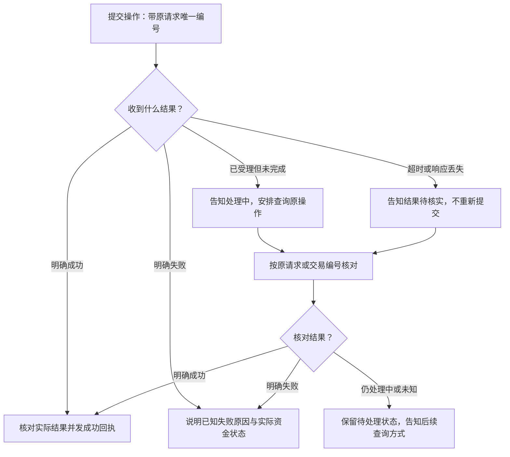

# 场景 PRD 完整参考清单

> 最后更新：2026-09-18
> 适用：转账、账单分析、跨场景联动等业务场景负责人。安全专项与公共底座负责人参与交接评审。\
> 定位：从业务初稿到接口定稿的完整参考，供团队在评审过程中逐步补齐，不是本轮初稿的全部必填项。\
> 本轮入口：组员先按 初步 PRD 交付要求（已归档） 写业务初稿。本文按需查阅，不要求一次填完全部表格。\
> 使用方式：第二部分提供详细参考表格；第三部分用于细化流程图；第四部分由团队在接口定稿前共同检查。

## 一、参考清单使用说明

### 1. 分阶段使用

每个场景维护一份 PRD，随着评审逐步补齐：**功能范围、正常流程、异常处理、安全确认、输入输出与依赖、状态和结束条件、验收例子、待确认问题**。无需分别维护初稿和详细稿两套内容。

| 时机 | 本阶段补什么 | 主要参与者 |
|---|---|---|
| 当前业务初稿 | 用户目标、建议范围、主要流程、关键输入输出、主要异常、安全考虑、简单图和例子；允许明确标注待确认项 | 场景负责人 |
| 团队评审 | 确认本阶段范围、能力提供者、业务规则、安全要求和重要分支 | 场景负责人、Erwin、Ringo 及相关模块负责人 |
| 接口定稿前 | 补齐影响当前交接的结果语义、取消与恢复要求、确认规则和验收依据；技术侧形成公共接口 | 相关负责人共同完成 |

初稿是否合格以精简版要求为准，不以本文所有表格是否填满为准。技术实现方案由技术侧负责，不转嫁给业务初稿作者。

流程图放在同一份 PRD 中，或提供团队可访问的链接。一个场景包含多个完整任务时，每个任务分别写 SOP、画详细流程图。例如普通转账、定时转账、AA 收款分别描述；多个任务之间有关系时，再补一张场景总览图。

SOP 就是“一个任务通常怎样办、遇到例外怎样办”的步骤说明。沿用原 PRD 场景 SOP 模板（已归档） 的五个要素：**触发、步骤、例外、确认点、回执**。本清单在此基础上补充交接信息、状态、流程图和验收。

已经写好的 PRD 不必重写或强行调整章节，只要能逐项找到对应内容即可。不适用的项写“不适用 + 原因”；拿不准的规则写“待确认 + 需要谁决定”，不要自行补成既定规则。

### 2. 写到什么程度

- 用业务语言写清“需要什么能力、提供什么信息、期待什么结果、不同结果后怎么办”。
- 不要求业务负责人设计 API 地址、技术字段名、数据库表、LangGraph 代码或公共状态码。
- 整个任务要有输入输出；调用其他模块、等待用户或产生实际操作的关键步骤，也要有交接说明。普通展示和内部整理步骤不必逐个列接口。
- 一个 SOP 对应用户的一个完整任务，不是一个按钮，也不是整个系统。
- P0/P1/P2 表示优先级；另行注明本阶段是否实现。赛题相关功能要保留在范围表中，暂缓的写清安排。
- 本清单中的示例只解释写法，不代表团队已经确定业务额度、授权政策或功能范围。

### 3. 谁负责什么

| 角色 | 负责内容 |
|---|---|
| 场景负责人 | 用户需求、业务步骤、分支、依赖能力、结果文案与验收例子 |
| Erwin / 公共底座与模拟银行负责人 | 汇总跨模块依赖，确定公共能力，统一字段、状态、错误及恢复协议 |
| Ringo / 安全负责人 | 对齐权限、确认、验证、放行或阻断规则，以及安全验收 |
| 相关负责人共同评审 | 解决范围冲突和待定规则，确认接口能覆盖业务行为 |

PRD 和流程图提供接口设计依据；公共接口定稿后，技术侧还需形成统一的数据定义与接口验证，不能只靠文字约定。

## 二、PRD 详细参考项与表格

> 按评审进展选用相关表格，不必整段复制或全部填写。将尖括号中的提示替换为内容；第 3 节按完整任务展开，其余章节可在场景内共用。当前初稿的精简结构见 初步 PRD 交付要求（已归档）。

### 1. 基本信息与目标

| 项目 | 填写内容 |
|---|---|
| 场景名称 | <场景名> |
| 负责人 / 最后更新 | <姓名 / 日期> |
| 当前状态 | <初稿 / 待评审 / 已确认> |
| 目标用户 | <谁使用，有哪些与本场景相关的困难> |
| 一句话目标 | <用户说什么，系统帮他完成什么> |
| 用户故事 | <作为……，我希望……，这样可以……> |
| 现状与痛点 | <现在如何完成这件事，最值得解决的问题是什么> |

**成功标准**：<列出可验证的结果，不只写“方便、智能、安全”；若写完成率，说明测试范围、成功定义和计算方式。>

### 2. 功能范围

| 功能 / 完整任务 | 对应赛题要求或用户需要 | 优先级 | 交付阶段 | 本阶段做到哪里 | 本阶段不包含什么 |
|---|---|---|---|---|---|
| <普通转账等> | <具体要求> | <P0/P1/P2> | <当前/后续/待确认> | <明确行为> | <明确边界> |

后续功能保留范围即可，暂不要求拆出全部接口和开发任务。不要仅用“P1”代替“本阶段是否交付”。

### 3. 任务 SOP：<任务名称>

#### 3.1 触发与任务整体输入输出

- 一句话目标：<这一个完整任务要办成什么>
- 触发说法：<列 3—5 句真实口语，包括信息完整、省略和含糊的表达>
- 前提条件：<例如用户已经登录、具备查询权限；不满足时去哪里处理>

| 所需信息 | 是否必须 | 从哪里取得 | 缺失或冲突时怎么办 |
|---|---|---|---|
| <金额/账单时间范围等> | <是/否/条件必须> | <用户/账户系统/其他模块> | <追问/查询/拒绝等> |

**最终输出**：<用户拿到什么结果、报告、凭据或编号；哪些结果需要后续查询。>

用户身份和权限由系统核验，不能让模型根据用户说法自行认定。业务负责人只需说明身份与权限需求。

#### 3.2 正常步骤

| 步骤编号 | 谁负责 | 做什么 | 需要的信息 | 得到的结果 | 下一步 |
|---|---|---|---|---|---|
| S01 | <用户/场景模块/银行/安全模块等> | <一个清楚的动作> | <输入> | <输出> | <步骤编号或等待状态> |

多步骤任务说明用户能看到哪些计划和进度。执行后要核对实际结果，再向用户报告；不能只根据原计划生成成功回执。

#### 3.3 关键交接与依赖能力

只填写需要其他模块支持的交接点，可引用步骤表，避免重复抄写。

| 编号 / 对应步骤 | 需要谁提供什么能力 | 提供什么信息及来源 | 希望返回什么 | 无结果、失败或未知时怎么办 | 是否改变资金或其他数据 |
|---|---|---|---|---|---|
| D01 / Sxx | <模拟银行：查询收款人> | <用户输入的姓名或备注；系统核验的身份> | <无匹配/唯一匹配/多个候选，附必要的掩码信息> | <补充线索/让用户选择/查询失败时说明> | <只读查询> |
| D02 / Sxx | <某模块：执行具体操作> | <业务信息、必要授权> | <操作编号、真实结果、可做的下一步> | <描述查询或停止路径> | <会修改什么> |

同时说明本场景可以向其他场景提供哪些能力，沿用本表即可。需要的数据是否在模拟环境中存在、由谁提供或生成，也要写清。不要默认另一个组员会提供尚未讨论的功能。

#### 3.4 异常、修改与取消

| 编号 / 发生步骤 | 触发条件 | 对用户说什么或让用户做什么 | 系统下一步 / 回到哪里 | 已完成操作与资金如何处理 |
|---|---|---|---|---|
| E01 / Sxx | <信息不足或多个候选> | <追问内容> | <回答后回到哪一步> | <无写入/已有结果> |
| E02 / Sxx | <业务条件不满足> | <具体原因与选择> | <修改后重新检查/结束> | <如实说明> |
| E03 / Sxx | <用户修改、取消或重复提交> | <按所处阶段说明> | <确认是否失效、是否查询原操作> | <哪些能停止，哪些不能撤销> |
| E04 / Sxx | <工具失败、超时或结果未知> | <不确定的内容明确说明> | <核对/安全重试/等待/停止> | <不能把未知当成没执行> |
| E05 / Sxx | <部分任务已经完成> | <展示已完成与未完成项> | <继续/停止/已支持的撤销处理> | <不可撤销的结果保留> |

适用时还应覆盖：权限拒绝、验证失败、安全阻断、页面断线、服务重启、预约到期、外部结果变化。

填写重点：

- 提交前取消与提交后取消分别描述。停止后续步骤不代表已完成操作被撤销。
- 超时不能直接断言“银行已受理”“未扣款”或“失败”；先核对原操作。
- 重复点击、重复确认或重启恢复，不应导致同一操作执行两次。
- 明确取消的任务不能重启后自动继续；页面断线也不等于用户取消。
- 重试必须说明适用条件和停止条件；会修改数据的操作先核对原结果。具体次数可待技术评审确定。
- “转人工”“退款”“发通知”若属于下一步，要说明实际入口与提供者；暂未建设就标明限制。

#### 3.5 安全与确认点

| 对应步骤 / 敏感动作 | 谁有权操作 | 执行前展示哪些信息 | 需要何种确认或验证 | 哪些变化使原确认失效 | 未通过时怎么办 |
|---|---|---|---|---|---|
| <动钱/修改预约/访问敏感数据等> | <本人/获授权角色> | <对象、金额、时间、影响范围等> | <本人意愿确认/身份验证/安全放行> | <金额、对象或范围变化等> | <等待/重新核验/阻断> |

- 区分“用户同意”“身份验证通过”“安全模块放行”，不能相互替代。
- 明确哪些信息可以展示、哪些应掩码、哪些不能进入模型或日志；具体统一规则与 Ringo 对齐。
- 外部备注、网页或工具返回的文字不能改变权限和确认规则。相关场景补越权、信息套取或提示词注入的验收例子。
- 预约和周期操作须特别说明：创建时授权覆盖哪些未来操作，到执行时间是否再次确认，用户不在线怎么办，修改后是否重新授权。未决定时列为待确认，不能在流程图中默认自动执行。

#### 3.6 等待、结束与用户回执

| 当前情况 | 等谁 / 下一步由谁触发 | 已知实际结果 | 用户可以做什么 | 对用户的完整示例文案 |
|---|---|---|---|---|
| 等待补充信息 | <用户> | <已完成哪些查询> | <补充/取消> | <实际说法> |
| 等待确认或验证 | <用户/验证模块> | <尚未执行哪些动作> | <确认/修改/取消> | <实际说法> |
| 外部处理中 | <外部服务/后续查询> | <有证据已受理，最终结果未定> | <查询等> | <实际说法> |
| 结果待核实 | <原操作查询> | <是否受理或执行尚不确定> | <查询/等待等> | <实际说法> |
| 成功 / 失败 / 取消 / 部分完成 | <分别填写适用项> | <明确事实与完成范围> | <允许的后续动作> | <每种结果分别给回执> |

不适用的行可以删除。等待不是成功或失败；未知结果不是明确失败。分别说明“用户任务进度”和“银行交易/预约/AA 活动本身的结果”，公共状态码由技术侧统一。

至少提供一段正常路径和一段关键异常路径的完整对话。适老化说明重点包括：每次追问多少信息、如何展示金额与对象、如何解释风险、如何退出；语音功能是否实现另行明确。

#### 3.7 业务流程图

<在此插入流程图或团队可访问链接。按第三部分的要求绘制，图上步骤编号与本节表格一致。>

### 4. 验收例子

| 用例编号 | 对应任务 / 步骤 / 分支 | 前提与模拟数据 | 用户输入或操作 | 预期行为与最终结果 | 绝对不能发生什么 |
|---|---|---|---|---|---|
| T01 | <正常路径> | <具体条件> | <真实说法> | <包括实际数据变化和用户看到的结果> | <禁止行为> |
| T02 | <关键异常分支> | <具体条件> | <触发方式> | <返回位置或停止状态> | <禁止行为> |

正常路径与每条关键异常分支都应有对应例子；不限于检查回复是否好听。涉及实际操作时，还要检查是否真的执行、对象和金额是否正确、是否重复执行。

适用场景补充：未确认不能执行；验证失败或安全拒绝不能执行；修改后旧确认无效；重复提交不重复执行；超时先查原操作；中断恢复不重复执行；只读分析不擅自发起资金操作。

如果使用完成率等指标，填写：**测试集合、成功定义、通过数量 / 总数量、目标值**。安全底线单独验收，不能由整体完成率抵消。这里填写的是目标，测试完成前不能写成“已达成”。

### 5. 待确认问题与依据

| 问题编号 | 尚未决定什么 | 影响哪些流程或接口 | 建议选项及影响（可选） | 需要谁确认 | 结论 / 状态 |
|---|---|---|---|---|---|
| Q01 | <具体问题> | <步骤或依赖编号> | <选择及代价> | <场景/Erwin/Ringo/其他负责人> | <待确认/结论> |

资料依据：<列出已使用的赛题、现有产品或其他来源及日期；区分外部要求、团队已定规则和待验证假设。没有查证的内容不要标“官方规定”。>

## 三、流程图怎么画

### 1. 组织方式

按“一个完整任务一张详细图”绘制。复杂场景可先画总览，再按普通转账、预约、AA 等拆分。多人协作需要明确责任时，可以按用户、业务模块、安全模块、模拟银行分区。

工具不限：Mermaid、draw.io、飞书画板等均可。交付应能查看且可修改；不要求场景负责人写代码。

### 2. 图上需要哪些元素

| 元素 | 推荐表示 | 必须说明什么 |
|---|---|---|
| 起点 | 圆角框 | 谁用什么请求或事件发起任务 |
| 处理步骤 | 矩形 | 编号、动作、责任方；例如“银行：查询原交易” |
| 判断与检查 | 菱形 | 明确的问题；每条出口写条件，如“唯一/多个/无匹配/查询失败” |
| 用户等待 | 标注“等待用户”的框 | 等待内容、用户可选动作、回答后回到哪里 |
| 外部等待 | 标注“等待外部结果”的框 | 等待对象、怎样再次查询或继续、何时停止自动处理 |
| 模块交接 | 标出模块名的处理框 | 引用依赖编号；具体输入输出放交接表，不把字段全部塞进图 |
| 敏感执行 | 标注“写操作”的处理框 | 会改变什么；前面需通过哪些确认、验证和安全检查 |
| 异常与恢复 | 带条件的分支箭头 | 失败后去哪里、能否重试、何时等待或停止 |
| 结束 | 独立结果框 | 成功、明确失败、取消或部分完成；对应真实结果 |
| 待确认规则 | 标注“待确认 Qxx” | 关联问题清单；不能画成已确定的自动路径 |

不要只靠红绿颜色区分状态；文字必须能独立读懂。

### 3. 重点检查六件事

1. **判断有完整出口。** 不只画“通过”，还要处理“不通过”和适用的“结果未知”；按实际情况列分支。
2. **等待能继续。** 写明谁回应、回应后回到哪里；取消或长期无回应如何处理也应有说明。
3. **执行前条件明确。** 哪一步真正扣款、创建预约或修改数据，图上可直接定位；用户修改关键内容后回到重新校验与确认的位置。
4. **异常有去处。** 异常不能只停在“报错”框；说明结束、等待、重新输入还是核对原操作。循环有停止条件。
5. **取消与恢复尊重事实。** 提交前、提交后、结果未知分别处理；恢复先核对已完成动作，不能从头再办一遍。
6. **图、文字、测试能互相对应。** 步骤用 Sxx、异常用 Exx、问题用 Qxx、测试用 Txx；图上不必塞所有编号，但必须能追溯。

重试、取消、断线恢复等跨越多个步骤的情况，可以另画一张小图或用表格说明适用位置，不必把主图画成密集交叉线。

### 4. 示例：一次写操作提交后的结果处理

下面仅演示局部异常分支，不是完整转账业务图。进入“提交”之前，相关输入校验、有效确认、身份验证和安全放行必须已完成；这些前置步骤仍需在实际业务图中画出。

“明确失败”不自动等于“从未扣款”，文案应依据银行返回的实际资金状态。查不到记录也不能直接据此重做，何时可以重新执行由接口语义和公共恢复规则决定。

### 5. 和 LangGraph 如何衔接

业务图先确定“产品应该怎样办事”，技术侧再映射成 LangGraph 的执行步骤、条件分支、暂停和恢复位置。两者应能对应，但不是每个方框都必须变成一个程序节点。

| 业务图中的内容 | 后续技术侧需要确定的事项 |
|---|---|
| 处理步骤与责任方 | 哪个模块执行，哪些步骤可合并或需要拆开 |
| 条件分支 | 分支依据是什么，由程序根据哪些结果判断 |
| 用户等待 | 暂停位置、等待内容和用户回应后的继续方式 |
| 模块交接 | 统一输入、输出、错误和可信身份信息 |
| 写操作与结果未知 | 防重复执行、原操作查询和安全恢复方式 |
| 进度、结果与核验记录 | 前端展示事件、保存哪些状态和审计证据 |

场景负责人不必设计检查点或代码结构；只需说明中断后用户期待怎样继续、哪些操作绝不能重复。业务图评审通过也不等于框架运行验证完成。

## 四、接口定稿前的完整检查与评审

> 以下由团队共同检查，针对本阶段实际交付范围；不作为当前初稿必须全通过的门槛。

### 团队共同检查

- [ ] 功能范围和交付阶段明确；优先级没有代替交付范围。
- [ ] 每个完整任务有触发、正常步骤、例外、确认点、回执。
- [ ] 任务整体和关键交接处都有输入输出，信息来源明确。
- [ ] 所需银行、安全和跨场景能力有提供者或待确认负责人。
- [ ] 流程图包含判断分支、等待、实际操作和不同结果；修改、取消、超时有路径。
- [ ] 等待、外部处理中、结果未知与最终结果没有混淆。
- [ ] 实际操作前的权限、确认和验证要求明确，未决规则已经标注。
- [ ] 部分完成、中断恢复、重复请求等适用问题有说明。
- [ ] 每条关键路径有验收例子，检查实际结果和禁止行为。
- [ ] 待确认问题已集中列出；没有把示例、假设或未来能力当成既定实现。

### 团队评审顺序

1. 场景负责人按图讲一遍正常任务，再走关键异常分支。
2. Erwin 核对底座、模拟银行和跨场景交接；Ringo 核对安全规则。
3. 对影响当前开发的问题作出决定，更新 PRD、图和对应验收例子。
4. 技术侧整理公共接口草案，并用最小流程验证关键接缝后定稿。

初稿可以带明确标记的待确认项；影响本阶段授权、状态、执行与交接的未决问题，应在相关接口冻结前解决。冻结后通过评审记录变更，并同步受影响的模块与用例。

## 五、与现有材料的关系

- PRD 场景 SOP 模板（已归档）：复用五要素结构、口语触发和完整回执写法。原示例中的金额阈值、验证码、到账时间只作历史示例，不作为当前已定规则。
- [系统框架（2026-09-19）](../architecture/system-framework-2026-09-19.md)：公共模块契约、安全执行入口、等待与恢复、审计等技术边界以该架构基线为准。
- [参赛规则与提交要求](../../官方资料/参赛规则与提交要求.md)：用于需求覆盖核对；这是仓库内整理资料，官方更新另行核实。

本清单不把 SOP 直接等同于已经可运行的 LangGraph 图，也不替各场景决定业务规则。业务负责人补齐行为，技术侧统一接口，相关负责人共同确认。
