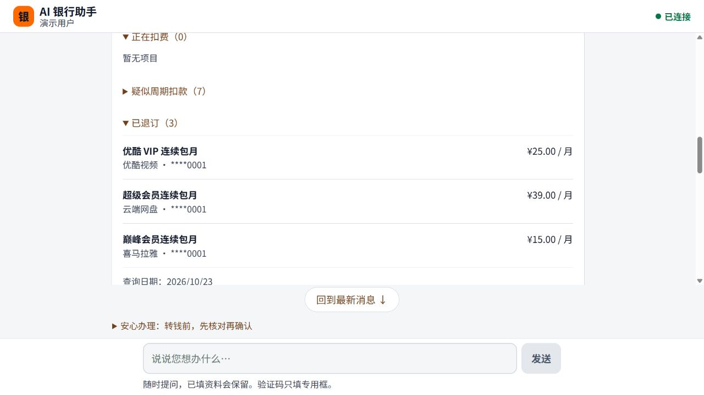
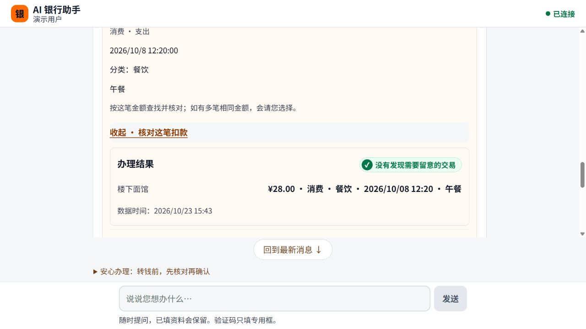

# 连续退订与已有业务走查（2026-10-23）

状态：已开发、已完成分层运行验证，待 PR 审查和用户验收；依赖未合并的 PR #253。不是生产银行、部署验收或 Ringo 专业签核。

## 已修问题

1. 转账验证后退订两个会员，第二次退订在确认前报错：复用记录被复制到多个任务，代码又拿复制任务去读取原验证。现在只接受真正归属正确、仍有效的原验证，同一记录只绑定一次。每笔业务仍独立确认，新会话、其他用户和操作专用验证不能借用。
2. 模型误把新对话接到旧对话任务时，消息一直等待：现在结束该条消息并提示回原对话，原任务与银行状态不变。
3. 补选账户后刷新账单又问账户，或明细刷新退回汇总：刷新沿用实际已完成的账户、日期和明细范围；报告刷新保留报告类型。
4. 退订确认一律说还要填验证码：改为有需要时提示验证，和会话内有效验证复用保持一致。
5. 实时通知丢失后一直“正在回复”：等待期间每 15 秒只读补查当前对话，并提供“查询办理进度”。补查失败有提示，恢复后清除；不会切到新对话或重新提交办理。
6. 消息处理失败只通过实时事件通知，断线后查不到原因：可读失败说明也保存在对话中，同一请求重放不重复添加，不泄露内部异常。

## 验证层与范围

| 层 | 结果 | 实际边界 |
| --- | --- | --- |
| 全后端回归 | 1,425 passed，686.60 秒 | 首次全量基线含连续退订修复；后续 API 改动另跑完整 API |
| 最终 API 回归 | 169 passed，343.08 秒 | 故障、恢复、导出、权限、旧确认及本轮新增反馈 |
| 订阅及相关增量 | 68 passed，52.89 秒 | 在最后失败消息持久化改动前；最终 API 单独覆盖该改动 |
| 前端测试与构建 | 70 passed；生产 build PASS | 丢失通知、补查失败恢复、保持原对话、停止计时器、只提交一次 |
| 真实 GLM-5.3 + HTTP + 隔离模拟银行 | 18 个场景最终复验 PASS | 多批走查与针对性补验合计，不是一次从头全绿，也不是 18 个浏览器用例 |
| 真实 React 浏览器 | 下列路径通过 | 5190 / 8019 独立库；原用户 5188 / 8018 保留 |
| AI 双轴审查 | 最终无未解决发现 | Spec 与 Standards 两个独立审查；不是人工或专业安全审批 |

真实 HTTP 的 18 条结果、状态、任务标识、银行操作计数与导出字节数见 [紧凑记录](evidence/business-e2e-results.json)，脚本见 [business_e2e.py](business_e2e.py)。只执行隔离演示库内的模拟操作，运行需显式传 `--allow-synthetic-execution`、新输出文件和匹配的数据目录；禁止指向用户正在操作的演示库。

| 范围 | 真实模型 HTTP | 真实页面 | 程序回归补充 |
| --- | --- | --- | --- |
| 账户与收款人 | 列表、缺资料、中途查询保留原单 | 输入金额→选账户→询问收款人→点妈妈续原转账 | 同名候选、银行过滤、私密资料不进聊天 |
| 转账 | 成功、改金额、旧确认拒绝、取消、手工资料不匹配；中风险暂停取消、高风险/未知风险不执行 | 300 元确认、验证码、成功回执 | 余额与银行拒绝、未知结果查询原操作、重复请求、新会话恢复、管理员人脸权限 |
| 账单 | 汇总、明细、月份、刷新、单笔核对、异常、空餐饮明细、银行不支持日期的失败 | 全账户汇总、刷新、餐饮两笔、展开核对面馆 28 元，结果“没有发现需要留意的交易” | 多候选选择、故障与范围/权限校验 |
| 报告与导出 | 真实生成报告；卡片与明细导出均实际下载，明细通过专用验证 | 完整说明抽屉、Esc 关闭并返回焦点 | 失败/空导出、过期、验证码重发、跨用户下载拒绝；页面没有导出入口，不冒称浏览器下载 |
| 订阅 | 查询、连续取消、批量歧义不直接执行、取消后状态和总额 | 转账→优酷退订→网盘退订；网盘确认前刷新恢复原任务；已开通 0 项/每月 0 元 | 主动放弃、疑似周期扣款仅给外部指引、已取消幂等、银行异常 |
| 帮助与恢复 | 帮助、注入/未知风险不产生银行写入 | 重启本轮后端后，不刷新页面发送报告请求，自动补查并显示结果；手动补查入口可见 | 丢失失败通知、只读补查失败再恢复、当前对话固定、跨线程续办拒绝可读 |

HTTP 连续链共 4 个新银行操作（两笔转账、两次退订），逐次重放相同确认请求不增加操作。页面链共 3 个新操作（300 元转账、两次退订），账单和报告不增加银行操作。

## 失败与修复证据

- 连续退订回归先出现 2 个失败，第二次取消 `SUBSCRIPTION_INTERNAL_ERROR`；修复后相关验证链 22 项通过，正序/倒序复用来源、重启后再转账都覆盖。
- 真实模型走查发现跨对话续办挂起，对应回归先失败后 8 项通过。
- 补选账户后的账单刷新回归先 2 失败/1 通过，修复后相关 16 项通过。
- 无实时通知的前端回归先失败；补查、固定原对话和失败提示恢复通过。
- 失败消息持久化回归先 2 失败；同时将原来断言“失败后没有助手消息”的 3 个旧断言改为核对可读提示、恢复后原回复及零业务执行，定向 3 项通过。
- 真实 HTTP 的早期脚本误用状态枚举/收款人标识、未完成账户与周期澄清、遗漏导出 submission_id、将银行范围拒绝当空结果、将 A5 汇总当空数据。这些测试脚本问题已校正，不能算产品修复；紧凑证据记录最终来源，不删改原始本地记录。

## 尚未覆盖的验收层

本轮没有重跑 390px / 200% 放大、真机和完整读屏检查；已有窄屏证据属于前置 PR #253。余额不足、超时未决、多候选、跨用户等故障主要是程序回归，不是本轮全部真实模型或浏览器故障注入。未执行真实人脸管理员批准、生产部署、真实银行交易、飞书同步；安全策略与专业签核保持原边界。

